<div align="center">

<p align="center">
  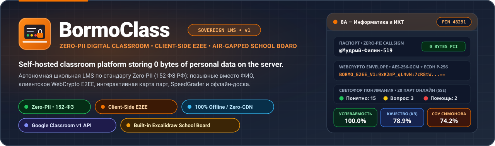
</p>

# BormoClass

**Self-Hosted Open Source Google Classroom Alternative & Sovereign Zero-PII LMS**<br>
Full Google Classroom v1 REST API parity (105 methods), 100% offline interactive school whiteboard, split-screen SpeedGrader, Simonov educational analytics, client-side WebCrypto AES-256-GCM encryption, and 0 bytes of server-side personal data under Russian Federal Law 152-FZ.

[](https://github.com/Bormotoon/BormoClass/actions/workflows/ci.yml)
[](LICENSE)
[](#-google-classroom-vs-bormoclass)
[-success.svg)](LICENSE)
[](#-quick-start--deployment)
[](docs/assets/zero-pii-flow.svg)
[](app/static/js/e2ee-crypto.js)
<br>
[](https://www.python.org/)
[](https://fastapi.tiangolo.com/)
[](app/schema.sql)
[](app/static/)
[](board-src/)
[](docker-compose.yml)
<br>
[](https://xn--80abidn3bem.xn--p1ai/)
[](https://www.donationalerts.com/r/bormotoon)
[](CONTRIBUTING.md)

**English** · [Русский](README.ru.md)

[Why BormoClass](#-why-bormoclass) ·
[Features](#-features) ·
[Screenshots](#-visual-tour--screenshots) ·
[Architecture](#-architecture--system-design) ·
[Zero-PII & Crypto](#-zero-pii--cryptographic-foundations) ·
[Pedagogical Analytics](#-pedagogical-methodology--grade-analytics) ·
[Quick Start](#-quick-start--deployment) ·
[REST API](#-rest-api--google-classroom-compatibility) ·
[Contributing](#-community-contributing--security) ·
[Support](#-support-the-project)

🌐 Project home: **[педобраз.рф](https://xn--80abidn3bem.xn--p1ai/)**

</div>

<br>

> [!NOTE]
> Every screenshot in this documentation illustrates a **synthetic live demonstration classroom** (*8A Computer Science & ICT*, *6B Mathematics*, *10A Python Algorithms*, *7V Physics*) generated with authentic decrypted Zero-PII student callsigns and live pedagogical telemetry. Zero real student personal data is collected, stored, or processed.

---

## 💡 Why BormoClass?

Modern educational institutions face a critical challenge: proprietary cloud learning management systems (LMS) such as Google Classroom, Microsoft Teams, and Canvas offer streamlined assignment workflows, but they demand exhaustive personal data collection, impose heavy vendor lock-in, and rely on centralized corporate cloud infrastructure. School-wide email accounts, legal student names, phone numbers, surveillance telemetry, and behavioral footprints are routinely uploaded to overseas cloud silos. In many jurisdictions — including the Russian Federation under **Federal Law 152-FZ** ("On Personal Data") and **Federal Law 273-FZ** ("On Education in the Russian Federation") — institutional data sovereignty and privacy mandates make reliance on proprietary US cloud services legally problematic or impossible.

**BormoClass** is the **first sovereign, self-hosted, 100% free and open-source alternative to Google Classroom**:

1. **True Self-Hosting & 100% Open Source (Apache-2.0):** Run BormoClass entirely on your institution's own servers, school VPS, or air-gapped local network. You own 100% of your data and infrastructure. Zero licensing fees, zero ads, zero telemetry, and zero risk of cloud account deplatforming or service sunset.
2. **Drop-In Google Classroom Experience:** Built around the iconic 4-screen layout that educators and students already master: **Stream**, **Classwork**, **People**, and **Grades** (*Лента*, *Задания*, *Пользователи*, *Оценки*). Teachers organize materials by topic, publish assignments with rubrics and deadlines, conduct class discussions, and grade submissions with zero learning curve.
3. **Full Google Classroom v1 REST API Parity (105 Methods):** Directly implements the official Google Classroom API Discovery v1 specification (`/v1/courses`, `/v1/courseWork`, `/v1/studentSubmissions`, etc.). School automation scripts, grade exporters, roster synchronizers, and bot integrations work out-of-the-box.
4. **Absolute Zero-PII Standard (152-FZ RF):** Physical servers, SQLite databases, HTTP session cookies, and operational logs store **0 bytes of student personal data**. Students onboard using anonymous procedurally generated callsigns (`Adjective-Noun-Code`) and 4-word recovery passphrases. Real names, email addresses, phone numbers, and Russian national identifiers (SNILS) are never requested, stored, or processed.
5. **Client-Side Zero-Knowledge Encryption (WebCrypto E2EE):** Any sensitive student submissions, private teacher remarks, rubric annotations, and canvas drawings are encrypted directly in the browser via WebCrypto **AES-256-GCM + ECDH P-256** using class PIN-derived keys. The backend server acts solely as a blinded content-addressable storage (CAS) engine.
6. **100% Offline Interactive School Board (Excalidraw 0.18.1):** Replaces the discontinued Google Jamboard with an integrated, air-gapped whiteboard featuring zero external CDN dependencies, complete Russian localization, and a dedicated Teacher Tools panel (`linear ruler`, `protractor`, `set square`, `compass`, and authentic Russian notebook rulings: 5mm grid, 1st-grade slanted guidelines, wide lines, music staves, and coordinate planes).
7. **Two-Pane SpeedGrader & Simonov Pedagogical Analytics:** Split-screen SpeedGrader with freehand vector annotations, rubrics, comment bank, Russian 5-point scale translation, and exact mathematical evaluation of **СОУ** (Degree of Student Learning), **КЗ** (Quality of Knowledge), and **Усп** (Absolute Performance).

---

### Google Classroom vs. BormoClass

| Architectural Dimension | Google Classroom | BormoClass (Self-Hosted Open Source Alternative) |
| :--- | :--- | :--- |
| **Hosting & Deployment** | Proprietary SaaS cloud (Google Cloud). Closed-source, subject to sanctions, outages, and regional blocks. | **100% Self-Hosted & Air-Gap Ready**. Run on your own school server, VPS, or LAN via Docker Compose in 60 seconds. |
| **Licensing & Cost** | Commercial subscription tiers (Google Workspace for Education Plus); corporate vendor lock-in. | **100% Free & Open Source (Apache-2.0)**. Zero subscription fees, zero ads, zero paywalls, zero telemetry. |
| **Data Sovereignty & Privacy** | Centralized corporate cloud. Mandatory student Google accounts with real personal data (PII). | **Absolute Zero-PII Standard**. 0 bytes student PII on server; strict 152-FZ regex firewall (`pii_guard.py`). |
| **Data Encryption at Rest** | Server-side transparent encryption under Google-managed cloud KMS keys. | **Client-Side Zero-Knowledge WebCrypto E2EE** (AES-256-GCM + ECDH P-256). Backend is blinded. |
| **Google Classroom API v1** | Official cloud API gated by Google Cloud Console project approvals and OAuth2 scopes. | **Full Google Classroom v1 REST API Parity (105 methods)** implemented locally under `/v1/`. |
| **Interactive School Whiteboard** | Deprecated / Discontinued Google Jamboard; requires external 3rd-party paid SaaS boards. | **Built-in Offline Excalidraw 0.18.1** with teacher geometry tools & Russian notebook rulings. |
| **Grading & SpeedGrader** | Basic grading pane; document annotations require Google Docs viewer integration. | **Full Split-Screen SpeedGrader** with vector canvas annotations, rubrics, comment bank & AST anti-plagiarism. |
| **Educational Analytics** | Raw arithmetic point averages; no localized pedagogical metrics. | **V. P. Simonov's Methodology** with real-time computation of **СОУ**, **КЗ**, and **Усп** percentages. |
| **Testing & Practice Sets** | Google Forms redirect; external tab switching with zero focus-loss awareness. | **Integrated Quiz Player (6 question types)** with tab visibility monitoring and hint-enabled Practice Sets. |
| **National Standards & SanPiN** | None. No awareness of national educational or hygienic regulations. | **Grade 1 homework ban** (`grade_level == 1`) and live **SanPiN 1.2.3685-21 screen-time timer**. |

---

## ✨ Features

<table>
<tr>
<td width="50%" valign="top">

### 🔒 Zero-PII & Client-Side E2EE
- **Pedobraz-Passport Onboarding:** Procedural callsigns (`Adjective-Noun-Code`) generated from a $250 \times 250$ dictionary ($>56.25\text{M}$ unique combinations).
- **Zero-Knowledge Recovery:** Account restoration via 4 secret words selected from a 512-word dictionary ($2^{36}$ entropy, 36 bits).
- **152-FZ PII Defense Firewall (`pii_guard.py`):** Server-side regex filters intercept and reject Russian full names (FIO), mobile phone numbers, emails, and SNILS.
- **Client-Side WebCrypto E2EE (`e2ee-crypto.js`):** Text envelopes (`BORMO_E2EE_V1:`) and binary blobs (`BC_E2EE_BLOB_V1`) encrypted via AES-256-GCM.
- **Gamified "Recess Pass":** Anti-bot tickets, rate-limiting, and `recess_seconds` gaming balance earned by solving educational tasks with exam lockout.

### 🏫 Smart Classroom & Live Telemetry
- **Interactive 3-Row Desk Layout:** Visual physical seating map (desks 1–40) with single-click attendance marking and desk assignment.
- **Real-Time Traffic Light Understanding (🟢🟡🔴):** Live reactive Server-Sent Events (**SSE** via `sse_hub.py`) broadcasting student comprehension status.
- **Fair Call Wheel:** Random student picker with non-repeating weekly history tracking.
- **Algorithmic Team Balancer:** Balanced student distribution using snake sorting and `do_not_pair` behavioral conflict constraints.
- **Ergonomic Auto-Seating:** Automated seating algorithm accounting for student visual acuity and physical height.
- **A4 Printable Desk Sheets:** One-click generation of printable PDF/A4 desk placards and teacher grading sheets.

### 📝 SpeedGrader, Rubrics & Simonov Analytics
- **Two-Pane SpeedGrader:** Document review pane on the left with freehand drawing, highlighter, rect box, and text callouts; grading rubrics on the right.
- **Visual Rubric Builder:** Multi-criterion rubrics with weighted scoring, criteria descriptors, and CSV import/export.
- **Comment Bank:** Reusable teacher comment chips with keyboard shortcuts (`#tag`).
- **Simonov Pedagogical Engine:** Exact real-time calculation of **СОУ** (Degree of Student Learning), **КЗ** (Quality of Knowledge), and **Усп** (Absolute Performance).
- **Russian 5-Point Grade Translation:** Automatic conversion from 100-point rubrics to traditional Russian 5-point marks (5, 4, 3, 2).

</td>
<td width="50%" valign="top">

### 📐 100% Offline Interactive Whiteboard
- **Air-Gapped Excalidraw Engine:** Custom bundle in `board-src/` and `app/static/board/` with zero external CDN requests and full Russian localization.
- **Authentic Notebook Rulings (`ruling.js`):** 5mm squared math grid, 1st-grade slanted guidelines (65° inclination), wide single lines, music staves, millimeter graph paper, and Cartesian coordinate axes.
- **Snapping Geometry Tools (`measure.js`):** 20 cm school ruler, 180° protractor, 45°/60° set squares, and drafting compass with magnetic snap points.
- **Zero-PII Board Storage:** Drawings stored in teacher's browser IndexedDB with optional encrypted backend backup (`BC_E2EE_BLOB_V1`).

### 🧪 Testing, Practice Sets & Plagiarism
- **Multi-Modal Quiz Player:** 6 question formats (`SINGLE_CHOICE`, `MULTIPLE_CHOICE`, `SHORT_TEXT`, `NUMERIC_TOLERANCE`, `MATCHING`, `ORDERING` with Drag-and-Drop).
- **Proctoring Telemetry:** Real-time countdown timer, submission lockouts, and tab focus loss detection (`visibilitychange`).
- **Interactive Practice Sets:** Step-by-step problem sets with progressive hints and embedded vector scratchpad.
- **Local AST & Winnowing Plagiarism Engine:** Client-side and server-side Zero-Knowledge originality verification using 5-gram token winnowing and Python Abstract Syntax Tree (AST) comparison.
- **FGOS & CASE Competency Matrix:** Link homework and quiz items directly to national curriculum standards.

### 🇷🇺 Russian School Standards & SanPiN
- **Grade 1 Homework Prohibition:** System-enforced ban on homework assignments for first-graders (`grade_level == 1`).
- **SanPiN 1.2.3685-21 Timer (`sanpin-timer.js`):** Enforces hygienic limits on continuous screen exposure (15 min for primary school, 25–30 min for middle school).

### 🌐 Interoperability & Admin Governance
- **Google Classroom v1 REST API:** Drop-in protocol parity for courses, coursework, submissions, announcements, and aliases.
- **RFC 5545 iCalendar (`.ics`):** Token-authenticated, cookie-free calendar feed for Apple Calendar, Thunderbird, and mobile devices.
- **OneRoster CSV & Data Takeout:** School timetable CSV ingestion and complete student Data Takeout ZIP archives.

</td>
</tr>
</table>

---

## 📸 Visual Tour & Screenshots

<table>
<tr>
<td width="50%" valign="top">
  <a href="docs/assets/screenshots/01-home-courses.png">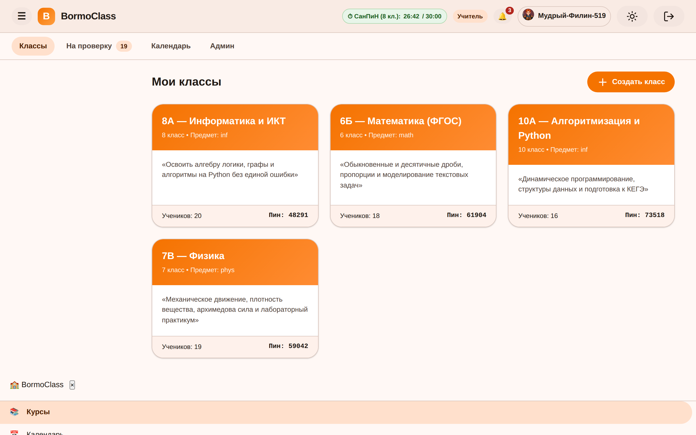</a>
  <br>
  <sub><b>01. Teacher Course Showcase & SanPiN Telemetry</b><br>
  Multi-course teacher dashboard displaying active classes (<i>8A Informatics</i>, <i>6B Mathematics</i>, <i>10A Python Algorithms</i>, <i>7V Physics</i>) with live student counters, course PINs, global drawer navigation, and the active SanPiN screen-time timer badge (<code>26:42 / 30:00</code>).</sub>
</td>
<td width="50%" valign="top">
  <a href="docs/assets/screenshots/02-class-stream.png">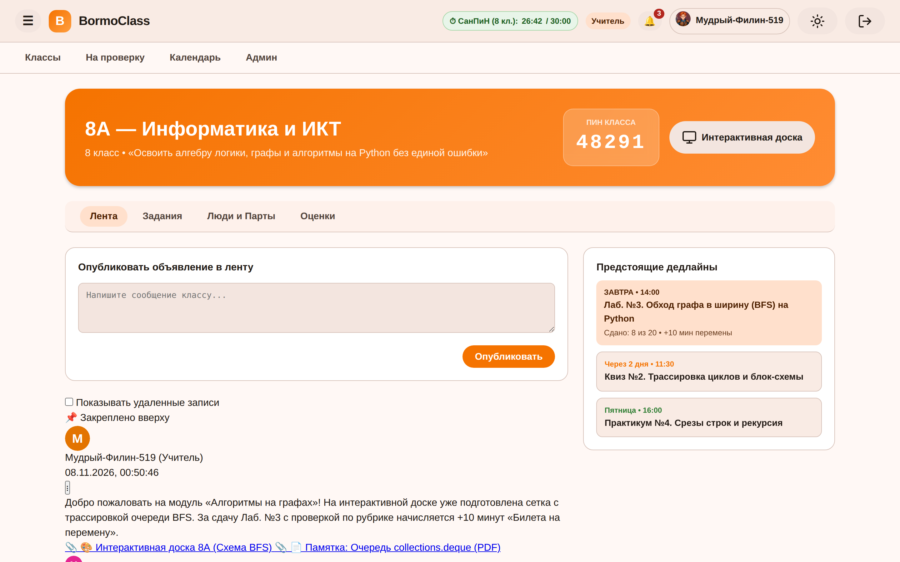</a>
  <br>
  <sub><b>02. Course Stream, 5-Digit PIN & Deadlines</b><br>
  Course stream header with Material Design 3 <i>Ember Newsroom</i> orange banner, 5-digit joining PIN (<code>48291</code>), upcoming deadline bucket, announcements feed with file attachments, and student discussions filtered through 152-FZ Zero-PII rules.</sub>
</td>
</tr>
<tr>
<td width="50%" valign="top">
  <a href="docs/assets/screenshots/03-seating-desks-traffic.png">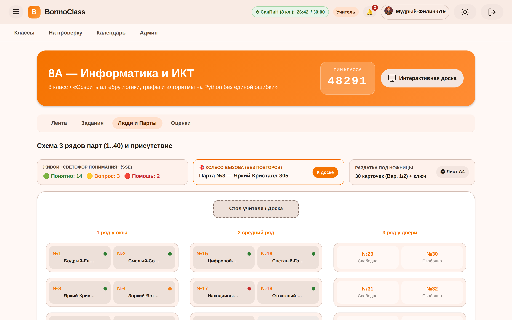</a>
  <br>
  <sub><b>03. 3-Row Desk Layout & SSE Traffic Light</b><br>
  Physical 3-row classroom desk map (desks 1–40, 20 enrolled students). Features real-time SSE Traffic Light telemetry (🟢 14, 🟡 3, 🔴 2), fair Call Wheel candidate card (<code>Парта №3 — Яркий-Кристалл-305</code>), and one-click printable A4 desk layout export.</sub>
</td>
<td width="50%" valign="top">
  <a href="docs/assets/screenshots/04-classwork-and-rubric.png">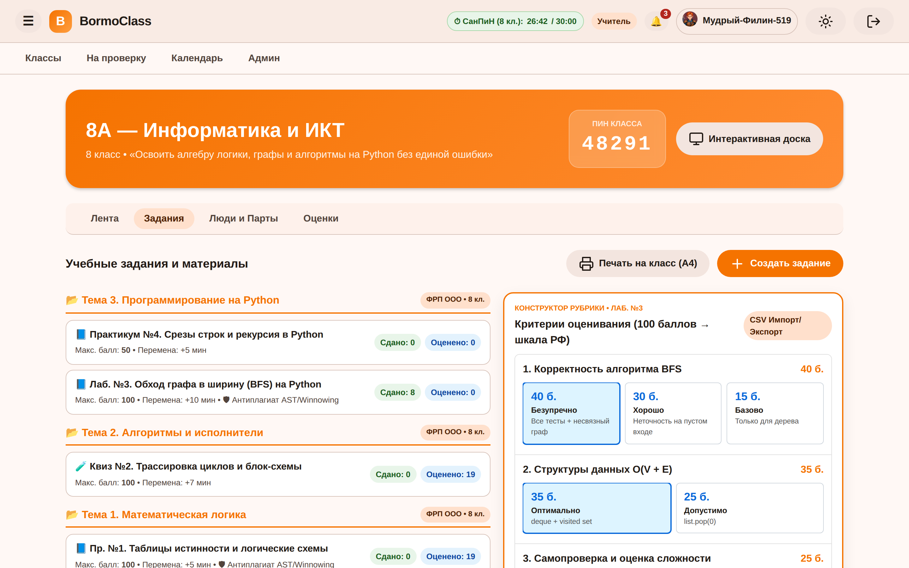</a>
  <br>
  <sub><b>04. Topic-Grouped Classwork & Rubric Builder</b><br>
  Classwork view categorized by national curriculum topics (<i>Mathematical Logic</i>, <i>Algorithms</i>, <i>Python Programming</i>) with assignments, quizzes, and practice sets. Demonstrates the open Visual Rubric Builder with criteria descriptors and automatic 5-point scale conversion.</sub>
</td>
</tr>
<tr>
<td width="50%" valign="top">
  <a href="docs/assets/screenshots/05-quiz-and-practice.png">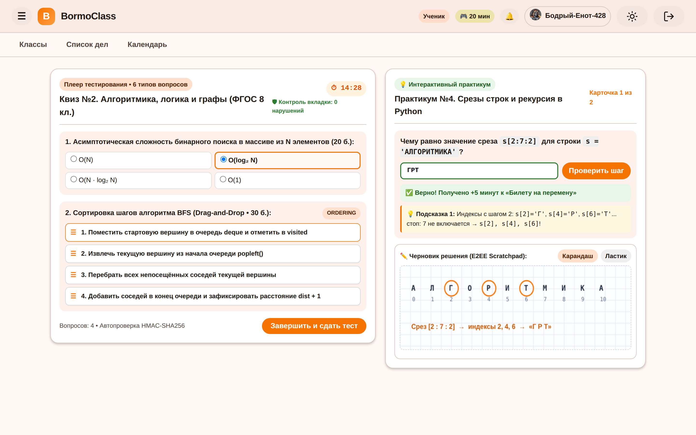</a>
  <br>
  <sub><b>05. Side-by-Side Quiz Player & Practice Set</b><br>
  Student testing interface featuring the timed Quiz Player (<code>14:28</code> timer, tab visibility monitor, Drag-and-Drop <code>ORDERING</code> question) paired with an Interactive Practice Set featuring progressive hints and an embedded E2EE vector scratchpad.</sub>
</td>
<td width="50%" valign="top">
  <a href="docs/assets/screenshots/06-speedgrader.png">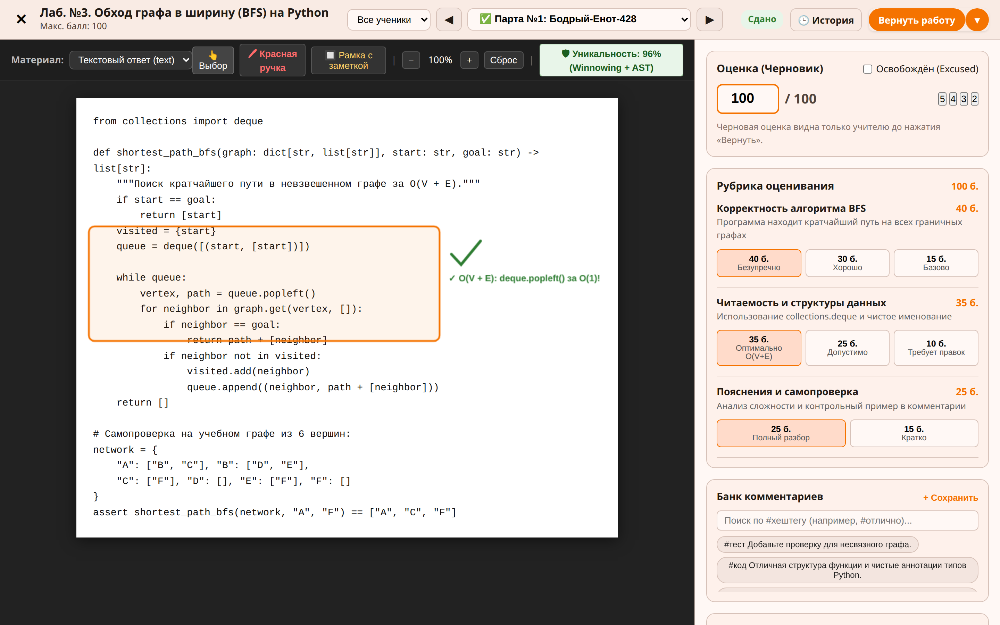</a>
  <br>
  <sub><b>06. Split-Screen SpeedGrader with Canvas Annotations</b><br>
  Grading teacher console reviewing a Python BFS lab submission. Features vector canvas annotations (highlight box, checkmark, sticky note), 96% AST & Winnowing originality badge, rubric scoring cards, and instant comment bank chips.</sub>
</td>
</tr>
<tr>
<td width="50%" valign="top">
  <a href="docs/assets/screenshots/07-gradebook-sou.png">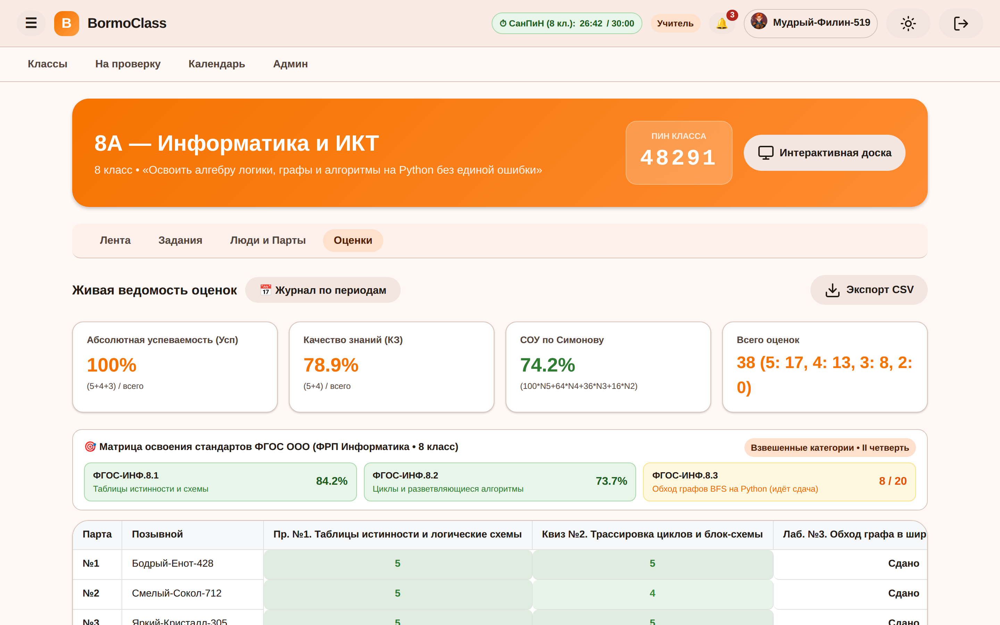</a>
  <br>
  <sub><b>07. Gradebook Matrix & Simonov Educational Analytics</b><br>
  Comprehensive gradebook matrix with student callsigns and calculated Russian 5-point grades. Top telemetry banner displays exact V. P. Simonov pedagogical indicators: <b>Усп: 100%</b>, <b>КЗ: 78.9%</b>, <b>СОУ: 74.2%</b>, with FGOS standards mastery tags.</sub>
</td>
<td width="50%" valign="top">
  <a href="docs/assets/screenshots/08-interactive-board.png">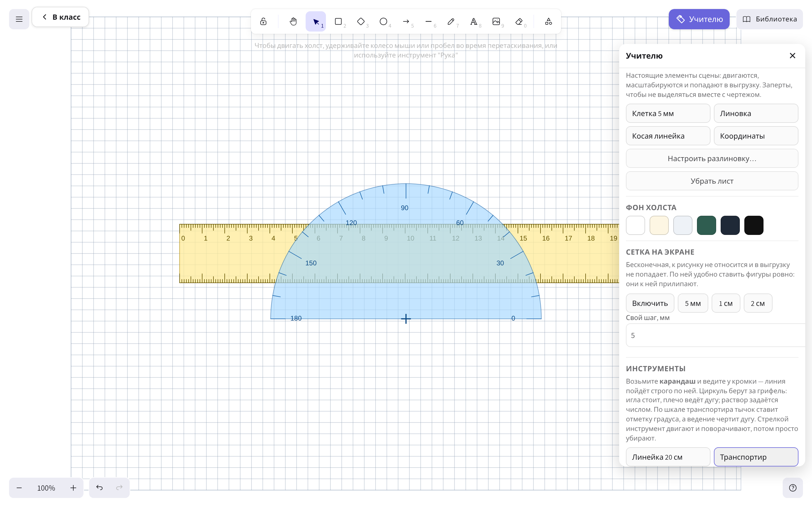</a>
  <br>
  <sub><b>08. Offline Excalidraw Whiteboard & Teacher Panel</b><br>
  100% offline interactive school whiteboard with zero external CDN calls. Displays the 5mm math squared ruling, 20 cm precision school ruler, 180° protractor, drawing canvas, and the open «Учителю» ruling and instrument selection dialog.</sub>
</td>
</tr>
<tr>
<td colspan="2" valign="top">
  <a href="docs/assets/screenshots/09-global-todo-calendar.png">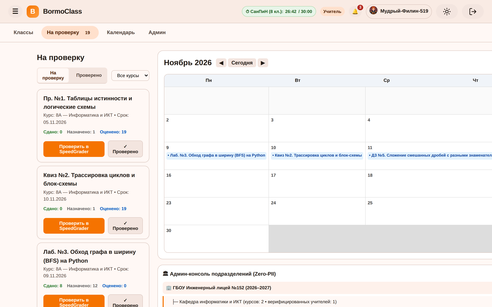</a>
  <br>
  <sub><b>09. Global Teacher "To-Review" Queue, RFC 5545 iCalendar & Admin Console</b><br>
  Centralized workflow dashboard showing the "To-Review" submission queue grouped by course, monthly Deadlines Calendar with one-click tokenized <code>.ics</code> WebCal subscription links, and the Zero-PII Organizational Units management console.</sub>
</td>
</tr>
</table>

---

## 🧩 Architecture & System Design

BormoClass is built upon a hardened, four-tier architecture engineered for extreme reliability, minimal memory footprint, and air-gapped deployment capability:

<p align="center">
  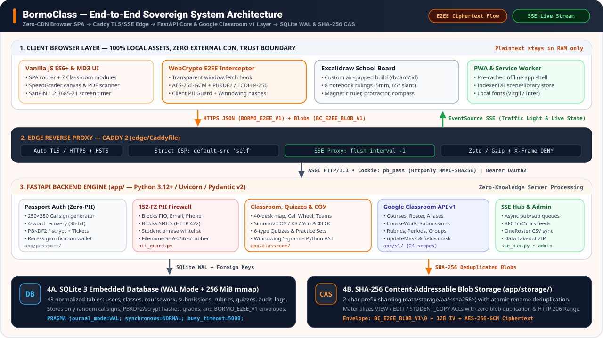
</p>

### Technology Stack

| Layer | Technology | Operational Responsibility |
| :--- | :--- | :--- |
| **Edge Proxy** | Caddy 2 / Nginx | TLS termination, automatic HTTPS, HTTP/2, static asset caching, and SSE streaming reverse proxy. |
| **Application Server** | FastAPI 0.115+, Python 3.12+ | High-performance asynchronous REST API, Google Classroom v1 endpoints, Simonov analytics, PII guardrails. |
| **Real-Time Hub** | Starlette SSE (`sse_hub.py`) | In-memory reactive Server-Sent Events bus broadcasting live traffic light and desk status to connected teachers. |
| **Relational Database** | SQLite 3.45+ in WAL mode | Zero-maintenance single-file ACID storage with 43 normalized tables, foreign key constraints, and zero concurrency lockups. |
| **Blob Engine (CAS)** | SHA-256 CAS Storage | Content-Addressable Storage deduplicating file uploads by SHA-256 hash with individual assignment copy materialization. |
| **Frontend UI** | Vanilla JS (ES2022) + MD3 | Zero-build modern frontend with Material Design 3 tokens (*Ember Newsroom* palette `#f57300`), local SVG icons, and zero CDN calls. |
| **Interactive Board** | Custom Excalidraw 0.18.1 | Fully localized, air-gapped collaborative whiteboard bundle running entirely in the client browser with IndexedDB persistence. |

---

### Content-Addressable Storage (CAS) & Assignment Materialization

All uploaded coursework materials, student submission attachments, scanned PDF homework pages, and canvas vector overlays are stored in a content-addressable storage engine (`app/storage/`):

1. **SHA-256 Ingestion & Deduplication:** When a file is uploaded, its SHA-256 checksum is computed. The binary content is stored under `data/storage/blobs/ab/cd/<sha256>`, ensuring identical attachments uploaded across multiple classrooms consume storage space exactly once.
2. **Assignment Materialization Modes:**
   - `STUDENT_COPY`: Upon student assignment access, the server materializes a distinct working copy linked to the student's submission.
   - `EDIT`: Shared group assignments where authorized students write to a unified collaborative document.
   - `VIEW`: Read-only reference materials (curriculum textbooks, worksheets, assignment rubrics).
3. **SVG Preview Generation & In-Browser PDF Scanning:** The CAS subsystem automatically generates lightweight SVG thumbnails for vector documents and bundles a client-side document scanner converting camera captures directly into PDF documents.

---

### Repository Layout

```text
BormoClass/
├── app/
│   ├── main.py                          # FastAPI application factory, lifespan handlers, middleware
│   ├── config.py                        # Environment configuration and SanPiN thresholds
│   ├── database.py                      # SQLite WAL connection management, pragmas, and migration runner
│   ├── schema.sql                       # Normalized relational schema (43 tables)
│   ├── classroom/                       # Core Classroom management & pedagogical engines
│   │   ├── classroom.py                 # Seating algorithms, call wheel, team balancer, duty roster
│   │   ├── router_courses.py            # Course CRUD, 5-digit PIN generation, invitations
│   │   ├── router_coursework_submissions.py # CourseWork & Submissions state machine
│   │   ├── router_speedgrader_rubrics.py    # Two-pane SpeedGrader, visual rubrics, comment bank
│   │   ├── router_gradebook_analytics.py    # Gradebook matrix & V. P. Simonov metrics calculation
│   │   ├── router_quizzes_and_sets.py   # Multi-modal quiz player, practice sets, AST plagiarism engine
│   │   ├── router_global.py             # To-review, To-do queues, RFC 5545 iCalendar feed
│   │   ├── router_notifications_admin.py# Org units, OneRoster CSV schedule import, Data Takeout ZIP
│   │   ├── sse_hub.py                   # In-memory Server-Sent Events reactive pub/sub bus
│   │   └── whiteboard.py                # Board metadata endpoints and encrypted session storage
│   ├── passport/                        # Zero-PII Pedobraz-Passport identity & authentication
│   │   ├── auth.py                      # Callsign generation, 4-word recovery, PBKDF2/scrypt hashing
│   │   ├── pii_guard.py                 # Multi-stage regex firewall blocking Russian full names, phones, SNILS
│   │   ├── crypto.py                    # Server-side cryptographic signatures and cookie validation
│   │   └── rate_limiter.py              # Sliding-window anti-bruteforce and bot prevention
│   ├── v1/                              # Google Classroom v1 REST API compatibility layer
│   │   ├── router_v1.py                 # Standard /v1/courses, /v1/courseWork endpoints
│   │   └── serializers.py               # Google Classroom API v1 JSON serializers and updateMask handlers
│   ├── storage/                         # Content-Addressable Storage (CAS) engine
│   │   ├── cas.py                       # SHA-256 deduplication and blob lifecycle
│   │   └── preview.py                   # Automatic SVG preview generation
│   ├── static/                          # 100% self-hosted frontend assets (Zero CDN)
│   │   ├── css/                         # Material Design 3 theme tokens (Ember Newsroom palette)
│   │   ├── js/                          # Vanilla ES2022 modules (e2ee-crypto.js, sanpin-timer.js)
│   │   └── board/                       # Pre-compiled offline Excalidraw bundle
│   └── templates/                       # Jinja2 HTML templates for server-rendered entry points
├── board-src/                           # Source code for custom Excalidraw 0.18.1 whiteboard
│   ├── components/                      # Teacher Panel, Ruling Dialog, Snap Layer
│   └── tools/                           # Geometry tools (ruler, protractor, set square, compass)
├── docs/                                # Technical specifications, guides, and visual assets
│   ├── assets/                          # SVG infographics and verified screenshots
│   └── google_classroom/                # Official Google Classroom v1 schema reference and ERDs
├── scripts/                             # Operator utilities, demo data seeders, and E2E smoke tests
├── tests/                               # Comprehensive automated test suite (pytest)
├── docker-compose.yml                   # Production container orchestration
├── Dockerfile                           # Hardened non-root container definition
└── requirements.txt                     # Pinned Python dependencies
```

---

## 🔐 Zero-PII & Cryptographic Foundations

BormoClass is architected from the ground up around a **Zero-Trust, Zero-PII** paradigm. No student personal data ever crosses the network boundary in plaintext.

<p align="center">
  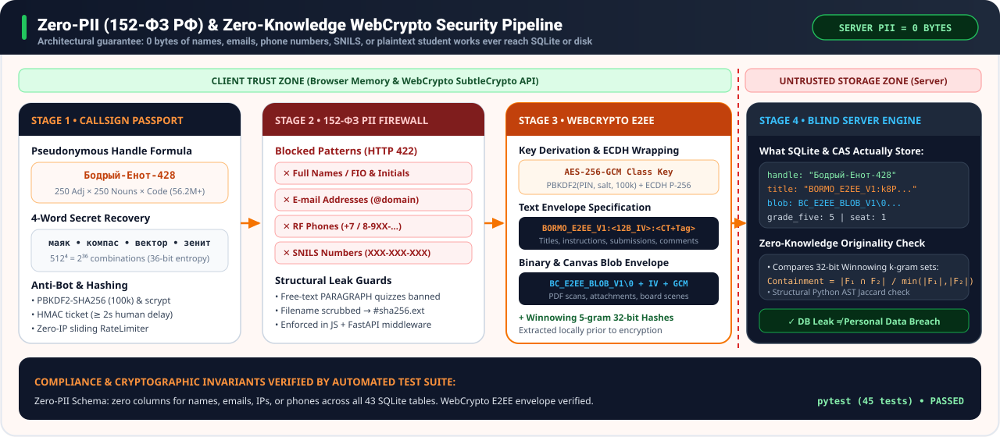
</p>

### 1. Procedural Callsigns & 4-Word Entropy

Instead of registering with legal names or email addresses, students receive procedurally generated credentials:

$$\text{Callsign Space} = 250\ (\text{Adjectives}) \times 250\ (\text{Nouns}) \times 900\ (\text{Codes: } 100\text{--}999) = 56,250,000\ \text{Combinations}$$

For account recovery, students are assigned a sequence of 4 secret words from an audited 512-word mnemonic dictionary:

$$\text{Recovery Entropy} = 512^4 = 68,719,476,736\ \text{States} \approx 36.0\ \text{bits of entropy}$$

Passwords and secret recovery phrases are normalized and hashed using **PBKDF2-HMAC-SHA256** (with 100,000 iterations and salt) or **scrypt**.

### 2. 152-FZ PII Defense Firewall (`pii_guard.py`)

Every incoming text payload (comments, stream announcements, forum replies) passes through a multi-stage regex defense engine before hitting SQLite:
- **Russian Full Names (FIO):** Intercepts standard 3-part Cyrillic nominative patterns (`Иванов Иван Иванович`).
- **Russian Phone Numbers:** Blocks national mobile prefixes (`+7`, `8`, `9xx` 10-digit formats).
- **Russian SNILS:** Blocks 11-digit national pension insurance identifiers (`\d{3}-\d{3}-\d{3}\s?\d{2}`).
- **Email Addresses:** Intercepts standard RFC 5322 email patterns.

Violations result in immediate request rejection with HTTP 422 Unprocessable Entity.

### 3. Client-Side WebCrypto E2EE Envelopes

Sensitive coursework files, canvas annotations, and teacher comments are encrypted client-side using the browser's native **WebCrypto API**:
- **Classroom Key Derivation:** Keys are derived from the 5-digit classroom join PIN and class ID using PBKDF2:
  ```javascript
  const keyMaterial = await crypto.subtle.importKey("raw", enc.encode(joinPin), "PBKDF2", false, ["deriveKey"]);
  const classKey = await crypto.subtle.deriveKey(
    { name: "PBKDF2", salt: enc.encode("bormo-class-pin:" + classId), iterations: 100000, hash: "SHA-256" },
    keyMaterial,
    { name: "AES-GCM", length: 256 },
    false,
    ["encrypt", "decrypt"]
  );
  ```
- **Text Envelope Format:** `BORMO_E2EE_V1:<base64url_iv_12bytes>:<base64url_ciphertext_and_tag>`
- **Binary Envelope Format:** 16-byte magic header `BC_E2EE_BLOB_V1\0` followed by 12-byte IV and AES-256-GCM encrypted payload.

---

## 📊 Pedagogical Methodology & Grade Analytics

BormoClass incorporates the standardized pedagogical analytics framework developed by Soviet and Russian educational methodologist **V. P. Simonov**. The system computes real-time diagnostic indicators directly from the gradebook matrix:

### 1. Absolute Performance (Успеваемость, Усп)
The percentage of students who attained satisfactory or higher grades (marks 5, 4, and 3) relative to the total number of grades submitted:

$$\text{Усп} = \frac{n_5 + n_4 + n_3}{N} \times 100\%$$

### 2. Quality of Knowledge (Качество знаний, КЗ)
The proportion of students demonstrating advanced mastery (marks 5 and 4):

$$\text{КЗ} = \frac{n_5 + n_4}{N} \times 100\%$$

### 3. Degree of Student Learning (Степень обученности учащихся, СОУ)
Simonov's weighted formula assigning non-linear pedagogical value coefficients to each grade level (Mark 5: 100%, Mark 4: 64%, Mark 3: 36%, Mark 2: 16%):

$$\text{СОУ} = \frac{100 \cdot n_5 + 64 \cdot n_4 + 36 \cdot n_3 + 16 \cdot n_2}{N}\%$$

#### Live Verification Example (from Course 8A Gradebook)
With $n_5 = 17$, $n_4 = 13$, $n_3 = 8$, $n_2 = 0$, and total grades $N = 38$:

$$\text{Усп} = \frac{17 + 13 + 8}{38} \times 100\% = \frac{38}{38} \times 100\% = \mathbf{100.0\%}$$

$$\text{КЗ} = \frac{17 + 13}{38} \times 100\% = \frac{30}{38} \times 100\% = \mathbf{78.9\%}$$

$$\text{СОУ} = \frac{100(17) + 64(13) + 36(8) + 16(0)}{38}\% = \frac{1700 + 832 + 288 + 0}{38}\% = \frac{2820}{38}\% = \mathbf{74.2\%}$$

These values match the real-time telemetry cards shown in the Gradebook Matrix screenshot.

---

### Russian 5-Point Grade Translation & Rubrics

BormoClass supports both `WEIGHTED_CATEGORIES` (e.g., Homework: 20%, Tests: 50%, Practice: 30%) and `TOTAL_POINTS` grading. Point-based assignments (0–100%) automatically map to traditional Russian 5-point marks according to ministerial recommendations:

| Criterion Range | Percentage | 5-Point Mark | Pedagogical Interpretation |
| :--- | :--- | :---: | :--- |
| **Excellent** | $85\% \le \text{Score} \le 100\%$ | **5** | Comprehensive mastery of curriculum standards. |
| **Good** | $70\% \le \text{Score} < 85\%$ | **4** | Solid comprehension with minor non-systematic errors. |
| **Satisfactory** | $50\% \le \text{Score} < 70\%$ | **3** | Minimum required threshold of standard competencies. |
| **Unsatisfactory** | $\text{Score} < 50\%$ | **2** | Critical knowledge gaps requiring intervention. |

---

## 🚀 Quick Start & Deployment

### 1. Run with Docker Compose (Recommended)

The fastest way to deploy BormoClass in production:

```bash
git clone https://github.com/Bormotoon/BormoClass.git
cd BormoClass
docker-compose up -d --build
```

Access the web interface at **`http://localhost:8010`**.

---

### 2. Run Locally (Bare-Metal Python)

**Prerequisites:** Python 3.12+ (or 3.13) and Git.

```bash
git clone https://github.com/Bormotoon/BormoClass.git
cd BormoClass

# 1. Create and activate virtual environment
python3 -m venv .venv
source .venv/bin/activate

# 2. Install production dependencies
pip install -r requirements.txt

# 3. Start development server
uvicorn app.main:app --host 0.0.0.0 --port 8010 --reload
```

---

### 3. Production Deployment with Caddy 2

Caddy provides automatic HTTPS with Let's Encrypt certificates and seamless SSE streaming:

```caddyfile
class.your-school.ru {
    encode zstd gzip

    # Proxy Server-Sent Events with buffer disabling
    @sse path /classroom/*/sse
    reverse_proxy @sse http://127.0.0.1:8010 {
        flush_interval -1
    }

    # Proxy all application traffic
    reverse_proxy http://127.0.0.1:8010 {
        header_up X-Forwarded-Proto {scheme}
        header_up X-Real-IP {remote_host}
    }
}
```

---

### Configuration Variables (`.env`)

| Variable | Default Value | Description |
| :--- | :--- | :--- |
| `DB_PATH` | `./bormoclass.db` | Absolute or relative path to the SQLite WAL database file. |
| `STORAGE_DIR` | `./data/storage` | Directory where CAS binary blobs and uploads are persisted. |
| `SECRET_KEY` | *(Auto-generated)* | 256-bit cryptographically secure secret for HMAC cookie signatures. |
| `SESSION_COOKIE_NAME` | `pb_pass` | Name of the secure HttpOnly authentication cookie. |
| `SANPIN_ENFORCE` | `true` | Enables client-side SanPiN screen-time counters and advisory pauses. |
| `CORS_ORIGINS` | `""` | Comma-separated list of allowed cross-origin origins (empty = same origin only). |
| `RATE_LIMIT_LOGIN` | `5/minute` | Rate limit ceiling on login attempts per IP/ticket to prevent bruteforcing. |

---

## 🧪 Testing & Quality Assurance

BormoClass maintains a strict automated test suite covering API contracts, cryptographic envelopes, Simonov mathematical invariants, and Zero-PII boundaries:

```bash
# Run complete test suite
pytest -v

# Run with coverage report
pytest --cov=app tests/

# Execute end-to-end smoke verification
python3 scripts/e2e_smoke.py
```

### Verified Test Matrix
- ✅ **Zero-PII Filter Gate (`test_pii_guard.py`):** Verified rejection of FIO, phone numbers, and SNILS.
- ✅ **WebCrypto E2EE Serialization (`test_crypto.py`):** Verified round-trip encryption/decryption of `BORMO_E2EE_V1`.
- ✅ **Simonov Mathematical Engine (`test_analytics.py`):** Unit verification of СОУ, КЗ, and Усп calculations against known benchmarks.
- ✅ **Google Classroom API v1 Parity (`test_v1_api.py`):** Verified REST compatibility and `updateMask` filtering.
- ✅ **Plagiarism Engine (`test_plagiarism.py`):** Verified 5-gram token winnowing and AST syntax tree matching.

---

## 📡 REST API & Google Classroom Compatibility

BormoClass serves as a true drop-in self-hosted replacement for Google Classroom, featuring full protocol parity with the official Google Classroom v1 REST API (all 105 discovery methods registered under the `/v1/` prefix):

| Endpoint Resource | HTTP Method | Description |
| :--- | :--- | :--- |
| `/v1/courses` | `GET`, `POST` | List active courses or create a new course with joining PIN. |
| `/v1/courses/{courseId}` | `GET`, `PATCH`, `DELETE` | Retrieve course metadata or update course state with `updateMask`. |
| `/v1/courses/{courseId}/aliases` | `GET`, `POST`, `DELETE` | Manage standardized administrative course aliases. |
| `/v1/courses/{courseId}/courseWork` | `GET`, `POST` | List or create assignments, quizzes, and practice materials. |
| `/v1/courses/{courseId}/courseWork/{id}/studentSubmissions` | `GET`, `PATCH` | Retrieve student submissions, modify state, or turn in work. |
| `/v1/courses/{courseId}/teachers` | `GET`, `POST`, `DELETE` | List or invite co-teachers and teaching assistants. |
| `/v1/courses/{courseId}/students` | `GET`, `POST`, `DELETE` | Manage enrolled students by Zero-PII callsigns. |
| `/v1/courses/{courseId}/rubrics` | `GET`, `POST`, `PUT` | Define multi-criterion evaluation rubrics. |
| `/v1/courses/{courseId}/gradingPeriods` | `GET`, `POST` | Configure quarters, trimesters, or academic semesters. |

### Specialized Administrative Endpoints
- **RFC 5545 iCalendar Feed:** `GET /api/calendar/feed.ics?token={user_token}` — Cookie-free WebCal subscription.
- **OneRoster CSV Schedule Import:** `POST /api/admin/oneroster/import` — Bulk ingest classes, periods, and rooms.
- **Data Takeout ZIP Archive:** `GET /api/user/takeout.zip` — Complete student portfolio export in an open format.

---

## 🤝 Community, Contributing & Security

Contributions are welcomed! Please read our [CONTRIBUTING.md](CONTRIBUTING.md) guide before submitting pull requests.

- **Found a bug?** Submit an issue via the [GitHub Issue Tracker](https://github.com/Bormotoon/BormoClass/issues).
- **Security Vulnerability?** Please read [SECURITY.md](SECURITY.md) and report vulnerabilities privately to `security@pedobraz.ru` or `bormotoon@gmail.com`.

### Acknowledgements
- **[Excalidraw](https://excalidraw.com/) (MIT License):** Custom offline adaptation for sovereign school classrooms.
- **[FastAPI](https://fastapi.tiangolo.com/):** Modern asynchronous web framework for Python.
- **[SQLite](https://sqlite.org/):** High-reliability embedded database engine.

---

## ❤️ Support the project

BormoClass is free, open source, and built in the author's spare time. If it empowers your school,
classroom, or educational projects, consider supporting development:

[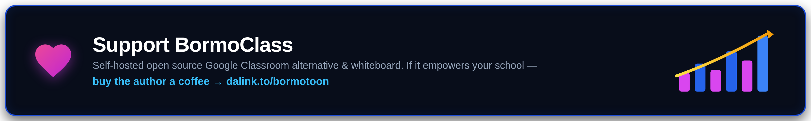](https://www.donationalerts.com/r/bormotoon)

A ⭐ on GitHub helps too — it makes the project easier for other educators and schools to find.

---

## 📜 License

BormoClass is distributed under the **[Apache License 2.0](LICENSE)**.

```text
Copyright 2026 BormoClass Contributors (PedObraz.RF)

Licensed under the Apache License, Version 2.0 (the "License");
you may not use this file except in compliance with the License.
You may obtain a copy of the License at

    http://www.apache.org/licenses/LICENSE-2.0

Unless required by applicable law or agreed to in writing, software
distributed under the License is distributed on an "AS IS" BASIS,
WITHOUT WARRANTIES OR CONDITIONS OF ANY KIND, either express or implied.
See the License for the specific language governing permissions and
limitations under the License.
```

---

<div align="center">

Made with ❤️ for teachers and students who believe privacy in education is a fundamental right.

[🌐 Project Home](https://xn--80abidn3bem.xn--p1ai/) ·
[🐛 Report Bug](https://github.com/Bormotoon/BormoClass/issues) ·
[💬 Request Feature](https://github.com/Bormotoon/BormoClass/issues) ·
[☕ Support Development](https://www.donationalerts.com/r/bormotoon)

</div>
