<div align="center">

<p align="center">
  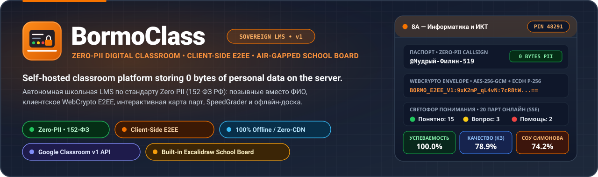
</p>

# BormoClass

**Self-Hosted Open Source аналог Google Classroom со встроенной интерактивной доской и защитой приватности Zero-PII**<br>
Полноценная свободная альтернатива Google Классу для школ, колледжей и вузов: привычные 4 раздела курса (Лента, Задания, Пользователи, Оценки), 100% паритет со спецификацией Google Classroom v1 REST API (все 105 методов), двухпанельный SpeedGrader, автономная доска Excalidraw, педагогическая аналитика по методике В. П. Симонова и 0 байт персональных данных на сервере по 152-ФЗ РФ.

[](https://github.com/Bormotoon/BormoClass/actions/workflows/ci.yml)
[](LICENSE)
[](#-сравнение-google-classroom-vs-bormoclass)
[-success.svg)](LICENSE)
[](#-быстрый-старт-и-развёртывание)
[](docs/assets/zero-pii-flow.svg)
[](app/static/js/e2ee-crypto.js)
<br>
[](https://www.python.org/)
[](https://fastapi.tiangolo.com/)
[](app/schema.sql)
[](app/static/)
[](board-src/)
[](docker-compose.yml)
<br>
[](https://xn--80abidn3bem.xn--p1ai/)
[](https://www.donationalerts.com/r/bormotoon)
[](CONTRIBUTING.md)

[English](README.md) · **Русский**

[Зачем это нужно](#-зачем-нужен-bormoclass) ·
[Возможности](#-возможности) ·
[Скриншоты](#-визуальный-тур-и-скриншоты) ·
[Архитектура](#-архитектура-и-системный-дизайн) ·
[Zero-PII и криптография](#-стандарт-zero-pii-и-криптографический-фундамент) ·
[Аналитика по Симонову](#-педагогическая-методология-и-аналитика-по-в-п-симонову) ·
[Быстрый старт](#-быстрый-старт-и-развёртывание) ·
[REST API](#-rest-api-и-совместимость-с-google-classroom) ·
[Участие](#-участие-в-разработке-и-безопасность) ·
[Поддержать](#-поддержать-проект)

🌐 Страница проекта: **[педобраз.рф](https://xn--80abidn3bem.xn--p1ai/)**

</div>

<br>

> [!NOTE]
> На всех скриншотах в этой документации показан **живой демонстрационный учебный класс** (*«8А — Информатика и ИКТ»*, *«6Б — Математика»*, *«10А — Алгоритмизация и Python»*, *«7В — Физика»*) с расшифрованными Zero-PII позывными учеников и реальной педагогической телеметрией. Реальные персональные данные учеников в системе никогда не собираются, не обрабатываются и не хранятся.

---

## 💡 Зачем нужен BormoClass?

Образовательные учреждения, школы, колледжи и преподаватели столкнулись с острой необходимостью замены зарубежных облачных платформ управления обучением (в первую очередь **Google Classroom** / Google Класс, а также Microsoft Teams и Canvas). Причины очевидны: санкционные риски, блокировки аккаунтов со стороны зарубежных провайдеров, прекращение работы сервисов (таких как Google Jamboard), требования цифрового суверенитета, а также строгое законодательство: **152-ФЗ** («О персональных данных») и **273-ФЗ** («Об образовании в РФ»). Коммерческие облачные сервисы требуют создания обязательных учетных записей с реальными ФИО, телефонами, почтой и СНИЛС детей, отправляя персональные данные и цифровой след за рубеж.

**BormoClass** — **первый полноценный self-hosted open source аналог Google Classroom**, созданный для быстрого и независимого внедрения:

1. **Настоящий Self-Hosted & 100% Open Source (Apache-2.0):** Платформа разворачивается на собственном сервере школы, личном VPS или даже в локальной изолированной сети (LAN) без доступа в интернет за пару минут через Docker Compose. Вы полностью контролируете свои данные и инфраструктуру. Никаких платных тарифов, рекламы, скрытых подписок и риска внезапного отключения сервиса вендором.
2. **Привычный интерфейс и сценарии Google Classroom:** Структура курса воспроизводит 4 классических экрана Google Classroom: **«Лента»** (Stream), **«Задания»** (Classwork), **«Пользователи»** (People) и **«Оценки»** (Grades). Преподавателям и ученикам не нужно переучиваться — все действия (рубрики, дедлайны, темы, прикрепление файлов, проверка работ) работают точно так же, как в привычном Google Классе.
3. **100% паритет с Google Classroom v1 REST API (105 методов):** Полная контрактная реализация официальной спецификации Google API Discovery v1 (`/v1/courses`, `/v1/courseWork`, `/v1/studentSubmissions` и т.д.). Любые школьные скрипты интеграции, чат-боты, выгрузки оценок и автоматизации продолжают работать без переписывания кода.
4. **Абсолютный стандарт Zero-PII (152-ФЗ РФ):** Физический сервер, базы данных SQLite, HTTP-куки и логи содержат **ровно 0 байт персональных данных**. Ученики входят в систему по процедурно генерируемым словарным позывным (`Прилагательное-Существительное-Код`) и восстанавливают доступ по 4 секретным словам. ФИО, телефоны, email и СНИЛС физически не запрашиваются, не сохраняются и блокируются встроенным шлюзом `pii_guard.py`.
5. **Клиентское Zero-Knowledge шифрование (WebCrypto E2EE):** Любые конфиденциальные работы учеников, комментарии преподавателя, рукописные аннотации и рисунки на доске шифруются непосредственно в браузере по алгоритму WebCrypto **AES-256-GCM + ECDH P-256** с ключом на базе PIN-кода класса. Сервер видит только непрозрачные зашифрованные бинарные блобы.
6. **Встроенная замена Google Jamboard — 100% автономная доска:** Интегрированная сборка **Excalidraw 0.18.1** с вырезанными внешними вызовами, нулевой зависимостью от сторонних CDN, полной русификацией и панелью «Учителю» (линейка, транспортир, треугольник, циркуль и аутентичные школьные разлиновки: клетка 5 мм, косая линейка для 1 класса, широкая линейка, нотный стан, координатная сетка).
7. **SpeedGrader и педагогическая аналитика по В. П. Симонову:** Двухпанельный просмотр работ с векторными пометками, рубриками и банком комментариев, автоматический расчет степени обученности учащихся (**СОУ**), качества знаний (**КЗ**) и абсолютной успеваемости (**Усп**) с переводом в государственную 5-балльную шкалу оценок.

---

### Сравнение: Google Classroom vs. BormoClass

| Параметр сравнения | Google Classroom | BormoClass (Свободный Self-Hosted аналог) |
| :--- | :--- | :--- |
| **Развёртывание и владение** | Закрытое облако Google Cloud. Риск санкций, отключения аккаунтов и недоступности из РФ. | **100% Self-Hosted & Автономность**. Разворачивается на сервере школы, VPS или в локальной сети за 60 секунд. |
| **Стоимость и лицензия** | Коммерческие подписки (Google Workspace for Education); привязка к вендору. | **100% бесплатно и Open Source (Apache-2.0)**. Никакой рекламы, подписок, монетизации и ограничений. |
| **Суверенитет и 152-ФЗ** | Корпоративное облако. Обязательные аккаунты с реальными ФИО и передачей данных за рубеж. | **Абсолютный стандарт Zero-PII**. 0 байт ПДн на сервере, защита от ввода ФИО, телефонов и СНИЛС по 152-ФЗ. |
| **Шифрование данных** | Серверное шифрование ключами Google KMS. Данные доступны облачному провайдеру. | **Клиентское сквозное шифрование (E2EE)** на WebCrypto (AES-256-GCM). Сервер «ослеплен». |
| **Google Classroom API v1** | Требует создания проектов в Google Cloud Console, сервисных аккаунтов и OAuth2. | **100% паритет REST API (все 105 методов)** спецификации Google Classroom v1 прямо на вашем сервере. |
| **Интерактивная доска** | Google Jamboard закрыт; требует подключения сторонних платных SaaS-сервисов. | **Встроенная автономная Excalidraw 0.18.1** с чертежными инструментами и школьными сетками тетрадей. |
| **SpeedGrader и проверка** | Базовая панель; комментирование требует подключения Google Docs. | **Полноценный двухпанельный SpeedGrader** с векторным слоем аннотаций, рубриками и банком комментариев. |
| **Педагогическая аналитика** | Простой средний арифметический балл без учета методики оценки. | **Методика В. П. Симонова** с автоматическим расчетом показателей **СОУ**, **КЗ** и **Усп** в реальном времени. |
| **Тестирование и антиплагиат** | Перенаправление в Google Forms; ученик может переключать вкладки. | **Плеер тестов (6 типов вопросов)** с контролем потери фокуса вкладки и локальный AST-антиплагиат. |
| **Нормы СанПиН и Минпроса** | Отсутствуют. Сервису неизвестны требования санитарных правил РФ. | **Запрет ДЗ для 1 класса** (`grade_level == 1`) и программный таймер непрерывной работы с экраном по **СанПиН**. |

---

## ✨ Возможности

<table>
<tr>
<td width="50%" valign="top">

### 🔒 Zero-PII и клиентское E2EE-шифрование
- **Система «ПедОбраз-Паспорт»:** Словарные позывные (`Прилагательное-Существительное-Код`) из словаря $250 \times 250$ (более $56.25\text{ млн}$ уникальных комбинаций).
- **Восстановление без почты:** 4 секретных слова из словаря в 512 слов ($2^{36}$ состояний, 36 бит энтропии).
- **Шлюз защиты 152-ФЗ (`pii_guard.py`):** Серверные регулярные выражения перехватывают и блокируют попытки отправки ФИО, телефонов РФ, email и СНИЛС.
- **Браузерное WebCrypto E2EE (`e2ee-crypto.js`):** Текстовые конверты (`BORMO_E2EE_V1:`) и бинарные файлы (`BC_E2EE_BLOB_V1`) шифруются ключом AES-256-GCM.
- **Геймификация «Билет на перемену»:** Игровой кошелек `recess_seconds`, защита от брутфорса, анти-бот талоны и блокировка игр во время контрольных.

### 🏫 Умный класс и живая телеметрия
- **Схема рассадки по партам (1–40, 3 ряда):** Интерактивная рассадка кабинета в 1 клик с отметкой присутствия и вызовом к доске.
- **Реактивный «Светофор понимания» (🟢🟡🔴):** Шина Server-Sent Events (**SSE** через `sse_hub.py`) мгновенно транслирует уровень усвоения темы учителю.
- **Честное «Колесо вызова»:** Случайный выбор ученика без повторов в течение учебной недели.
- **Балансировка команд «змейкой»:** Равномерное разделение на проектные группы с учетом матрицы поведенческих конфликтов `do_not_pair`.
- **Авто-рассадка по СанПиН:** Автоматическое распределение мест с учетом остроты зрения и роста учащихся.
- **Печать карточек А4:** Мгновенный экспорт схемы рассадки и раздаточных карточек для распечатки на принтере.

### 📝 SpeedGrader, рубрики и аналитика по Симонову
- **Двухпанельный SpeedGrader:** Просмотр сданной работы слева (карандаш, выделитель, рамки, заметки поверх работы) и панель оценивания по критериям справа.
- **Визуальный конструктор рубрик:** Настройка многокритериальных шкал, дескрипторов уровней и экспорт/импорт в формате CSV.
- **Банк комментариев:** Быстрые сниппеты типовых замечаний учителя с клавиатурной навигацией (`#тег`).
- **Педагогический движок Симонова:** Расчет показателей **СОУ** (степень обученности), **КЗ** (качество знаний) и **Усп** (абсолютная успеваемость).
- **Шкала оценок РФ:** Автоматический перевод баллов рубрик (0–100%) в государственные 5-балльные отметки (5, 4, 3, 2).

</td>
<td width="50%" valign="top">

### 📐 100% автономная интерактивная доска
- **Изолированное ядро Excalidraw:** Локальная сборка в `board-src/` и `app/static/board/` без внешних сетевых запросов и шрифтовых CDN.
- **Школьные разлиновки (`ruling.js`):** Клетка 5 мм, частая косая линейка для 1 класса (наклон 65°), широкая линейка, нотный стан, миллиметровка и декартовы оси координат.
- **Чертёжные инструменты (`measure.js`):** Школьная линейка 20 см, транспортир 180°, угольники 45°/60° и чертёжный циркуль с магнитной привязкой к узлам.
- **Zero-PII хранилище доски:** Сохранение холстов в локальной IndexedDB браузера учителя с опциональным E2EE-бэкапом (`BC_E2EE_BLOB_V1`).

### 🧪 Тестирование, практикумы и антиплагиат
- **Универсальный плеер тестов:** 6 типов вопросов (`SINGLE_CHOICE`, `MULTIPLE_CHOICE`, `SHORT_TEXT`, `NUMERIC_TOLERANCE`, `MATCHING`, `ORDERING` с Drag-and-Drop).
- **Контроль дисциплины:** Таймер обратного отсчета и фиксация переключения вкладки браузера (`visibilitychange`).
- **Интерактивные практикумы (Practice Sets):** Пошаговые тренажеры с адаптивными подсказками и встроенным векторным черновиком.
- **Локальный AST-антиплагиат:** Сравнение студенческих программ на Python по абстрактным синтаксическим деревьям (AST) и 5-граммный шинглинг текста (Winnowing).
- **Матрица стандартов ФГОС / CASE:** Прямая привязка заданий и вопросов к кодам образовательных стандартов.

### 🇷🇺 Стандарты школы РФ и нормы СанПиН
- **Запрет домашних заданий для 1 класса:** Автоматическая системная блокировка назначения ДЗ первоклассникам (`grade_level == 1`).
- **Таймер СанПиН 1.2.3685-21 (`sanpin-timer.js`):** Автоматический хронометраж непрерывной работы за монитором (15 мин для нач. школы, 25–30 мин для средних классов).

### 🌐 Общесистемные функции и интеграции
- **Google Classroom v1 REST API:** Полная поддержка официального протокола для курсов, заданий, сдачи работ, объявлений и алиасов.
- **Календарь RFC 5545 iCalendar (`.ics`):** Бескукисный WebCal-поток для подключения расписания дедлайнов в мобильные телефоны и календари.
- **OneRoster CSV и Data Takeout:** Импорт школьного расписания из таблиц и полная выгрузка портфолио ученика в ZIP-архив.

</td>
</tr>
</table>

---

## 📸 Визуальный тур и скриншоты

<table>
<tr>
<td width="50%" valign="top">
  <a href="docs/assets/screenshots/01-home-courses.png">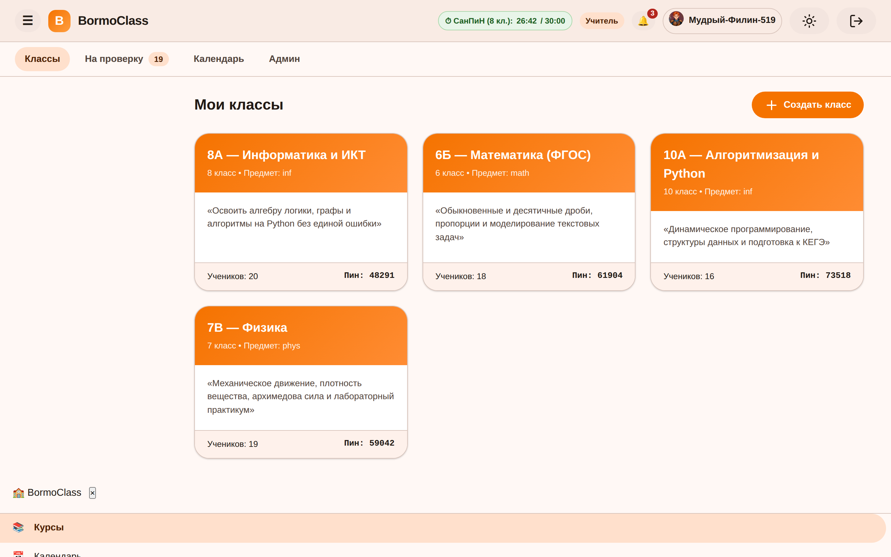</a>
  <br>
  <sub><b>01. Главная витрина курсов учителя и таймер СанПиН</b><br>
  Панель преподавателя с карточками активных учебных курсов (<i>«8А — Информатика»</i>, <i>«6Б — Математика»</i>, <i>«10А — Python»</i>, <i>«7В — Физика»</i>), счетчиками учеников, пин-кодами быстрого входа, боковым меню и индикатором непрерывной работы по СанПиН (<code>26:42 / 30:00</code>).</sub>
</td>
<td width="50%" valign="top">
  <a href="docs/assets/screenshots/02-class-stream.png">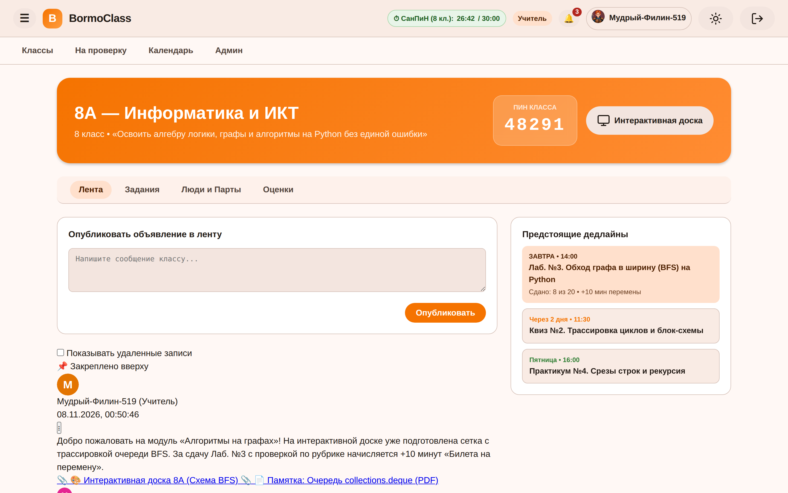</a>
  <br>
  <sub><b>02. Лента курса, 5-значный PIN и дедлайны</b><br>
  Фирменный оранжевый баннер Material Design 3 <i>Ember Newsroom</i>, 5-значный PIN-код подключения (<code>48291</code>), корзина ближайших сроков сдачи, публикация объявлений с вложениями и обсуждения, защищенные фильтром 152-ФЗ.</sub>
</td>
</tr>
<tr>
<td width="50%" valign="top">
  <a href="docs/assets/screenshots/03-seating-desks-traffic.png">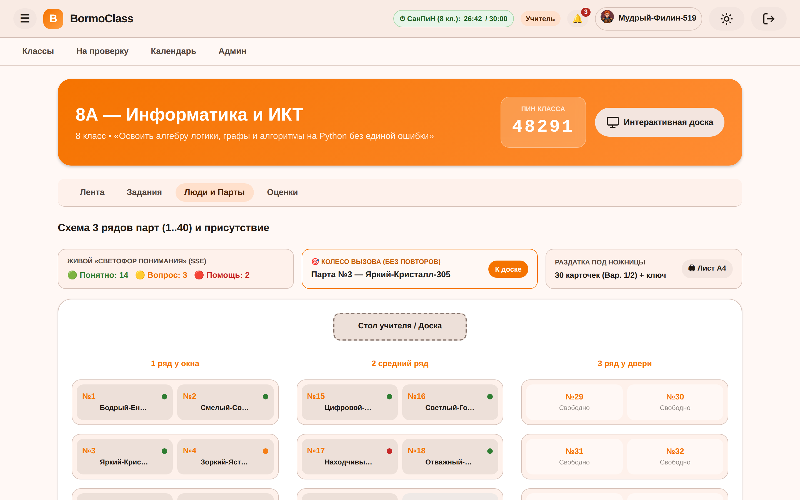</a>
  <br>
  <sub><b>03. Схема парт (3 ряда) и живой «Светофор понимания»</b><br>
  Физическая интерактивная карта класса на 40 парт (20 зачисленных учеников). Реактивная телеметрия SSE понимания темы (🟢 14, 🟡 3, 🔴 2), карточка кандидата «Колеса вызова» (<code>Парта №3 — Яркий-Кристалл-305</code>) и кнопка распечатки схемы на листе А4.</sub>
</td>
<td width="50%" valign="top">
  <a href="docs/assets/screenshots/04-classwork-and-rubric.png">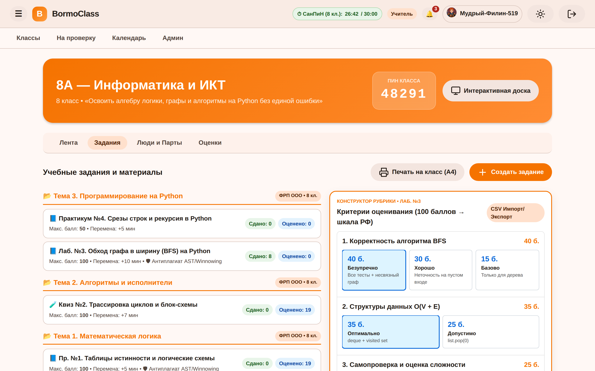</a>
  <br>
  <sub><b>04. Вкладка «Задания» по темам ФРП и конструктор рубрик</b><br>
  Тематическая группировка учебной программы (<i>«Тема 1. Математическая логика»</i>, <i>«Тема 2. Алгоритмы»</i>, <i>«Тема 3. Python»</i>) с заданиями, тестами и практикумами. Открыто модальное окно визуального конструктора рубрик с конвертацией баллов в 5-балльную шкалу.</sub>
</td>
</tr>
<tr>
<td width="50%" valign="top">
  <a href="docs/assets/screenshots/05-quiz-and-practice.png">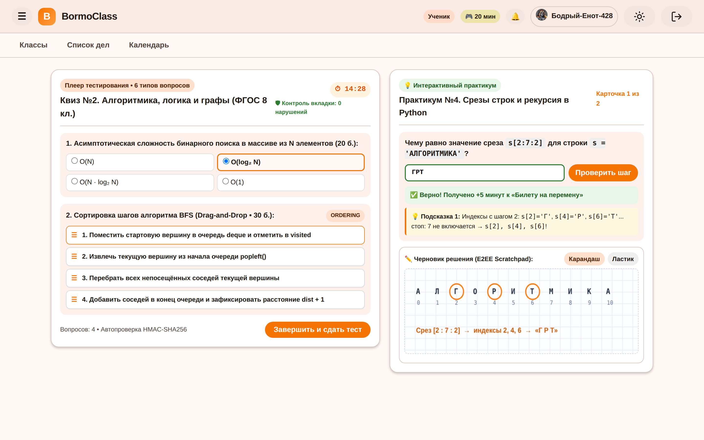</a>
  <br>
  <sub><b>05. Плеер тестов и интерактивный практикум с черновиком</b><br>
  Тестирование ученика: плеер теста с таймером (<code>14:28</code>), трекером потери фокуса окна и вопросом на упорядочивание <code>ORDERING</code> рядом с практикумом, оснащенным пошаговыми подсказками и векторным черновиком с рукописным решением.</sub>
</td>
<td width="50%" valign="top">
  <a href="docs/assets/screenshots/06-speedgrader.png">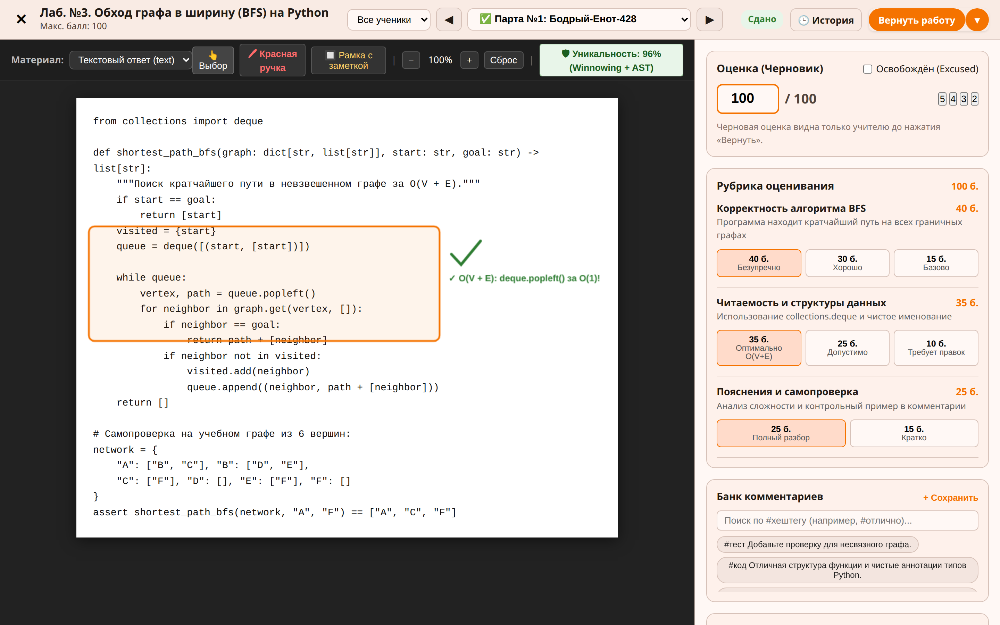</a>
  <br>
  <sub><b>06. Двухпанельный SpeedGrader с рукописными аннотациями</b><br>
  Консоль быстрой проверки лабораторной работы по Python (алгоритм BFS). Векторные пометки учителя поверх работы (рамка, галочка, комментарий), бейдж оригинальности 96% (AST + Winnowing), оценивание по критериям рубрики и банк быстрых комментариев.</sub>
</td>
</tr>
<tr>
<td width="50%" valign="top">
  <a href="docs/assets/screenshots/07-gradebook-sou.png">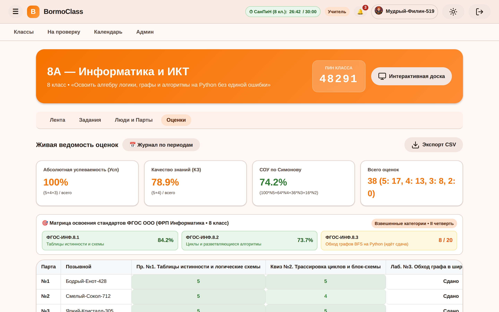</a>
  <br>
  <sub><b>07. Журнал оценок (Gradebook) и аналитика по Симонову</b><br>
  Матрица журнала с позывными учеников и выставленными отметками по 5-балльной шкале РФ. Верхняя панель в реальном времени отображает точный расчет показателей по В. П. Симонову: <b>Усп: 100%</b>, <b>КЗ: 78.9%</b>, <b>СОУ: 74.2%</b> и освоение стандартов ФГОС.</sub>
</td>
<td width="50%" valign="top">
  <a href="docs/assets/screenshots/08-interactive-board.png">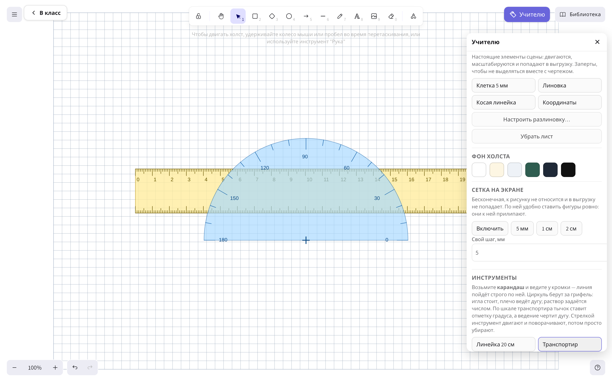</a>
  <br>
  <sub><b>08. Автономная доска Excalidraw и панель «Учителю»</b><br>
  100% локальная интерактивная школьная доска без CDN: лист тетради в клетку 5 мм, чертежная линейка 20 см, транспортир 180°, чертежи и открытая шторка диалога «Учителю» для смены разлиновок и вызова геометрических инструментов.</sub>
</td>
</tr>
<tr>
<td colspan="2" valign="top">
  <a href="docs/assets/screenshots/09-global-todo-calendar.png">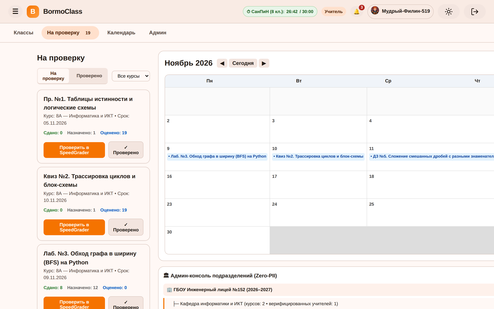</a>
  <br>
  <sub><b>09. Очередь проверки «На проверку», календарь RFC 5545 и панель подразделений</b><br>
  Сводный рабочий экран преподавателя: очередь поступивших работ со ссылками на SpeedGrader, календарь дедлайнов на ноябрь 2026 с подпиской на WebCal (<code>.ics</code>) и административная панель управления подразделениями школы (Org Units).</sub>
</td>
</tr>
</table>

---

## 🧩 Архитектура и системный дизайн

Архитектура BormoClass спроектирована по 4-уровневой схеме с упором на надежность, минимальное потребление оперативной памяти и возможность работы в изолированном контуре (Air-Gapped):

<p align="center">
  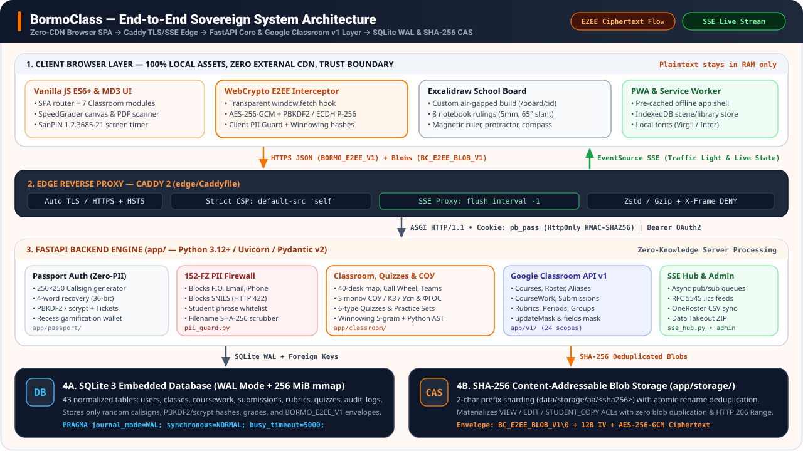
</p>

### Стек технологий

| Уровень системы | Технология | Назначение |
| :--- | :--- | :--- |
| **Edge-прокси** | Caddy 2 / Nginx | Терминация TLS, автовыпуск сертификатов HTTPS, сжатие HTTP/2, кэширование статики и проксирование SSE. |
| **Бэкенд-сервер** | FastAPI 0.115+, Python 3.12+ | Высокопроизводительный асинхронный REST API, реализация Google Classroom v1, формулы Симонова, фильтры ПДн. |
| **Реактивная шина** | Starlette SSE (`sse_hub.py`) | In-memory шина Server-Sent Events для мгновенной трансляции статусов рассадки и сигналов «Светофора». |
| **База данных** | SQLite 3.45+ (WAL-режим) | Не требующая администрирования ACID-база из одного файла, 43 таблицы с внешними ключами, нулевой риск блокировок. |
| **Файловое хранилище (CAS)** | SHA-256 CAS Engine | Хранилище с адресацией по содержимому (CAS), дедупликация файлов по SHA-256, материализация копий учеников. |
| **Веб-интерфейс** | Vanilla JS (ES2022) + MD3 | Интерфейс без сборщиков (no-build) на токенах Material Design 3 (*Ember Newsroom* `#f57300`), 0 внешних CDN. |
| **Интерактивная доска** | Сборка Excalidraw 0.18.1 | Полностью автономная русскоязычная доска, сохраняющая состояние в IndexedDB браузера педагога. |

---

### Хранилище с адресацией по содержимому (CAS) и копии заданий

Все материалы курсов, прикрепленные файлы, сканированные тетради и векторные слои сохраняются в специализированном CAS-хранилище (`app/storage/`):

1. **Дедупликация по SHA-256:** При загрузке файла рассчитывается контрольная сумма SHA-256. Содержимое размещается в каталоге `data/storage/blobs/ab/cd/<sha256>`. Если методический документ прикреплен сразу в 5 параллелях классов, на диске он хранится строго в одном экземпляре.
2. **Режимы доступа к материалам:**
   - `STUDENT_COPY`: Индивидуальная копия документа материализуется для каждого ученика при первом открытии задачи.
   - `EDIT`: Общий совместный документ для групповой проектной работы.
   - `VIEW`: Режим только для чтения (методички, условия олимпиад, критерии оценивания).
3. **SVG-превью и PDF-сканер документов:** Сервер на лету генерирует векторные миниатюры файлов, а встроенный веб-сканер позволяет фотографировать рукописные тетради на телефон и собирать их в оптимизированный PDF.

---

### Структура репозитория

```text
BormoClass/
├── app/
│   ├── main.py                          # Точка входа FastAPI, жизненный цикл приложения, CORS
│   ├── config.py                        # Чтение переменных .env, параметры сессий и таймеров СанПиН
│   ├── database.py                      # Подключение SQLite WAL, настройка PRAGMA, применение миграций
│   ├── schema.sql                       # Нормализованная схема данных (43 таблицы)
│   ├── classroom/                       # Логика учебного процесса и педагогические модули
│   │   ├── classroom.py                 # Алгоритмы рассадки парт, колесо вызова, балансировка команд
│   │   ├── router_courses.py            # Курсы, генерация 5-значных PIN, зачисление по коду
│   │   ├── router_coursework_submissions.py # Стейт-машина заданий и сдачи студенческих работ
│   │   ├── router_speedgrader_rubrics.py    # Двухпанельный SpeedGrader, рубрики, банк комментариев
│   │   ├── router_gradebook_analytics.py    # Матрица журнала оценок и формулы В. П. Симонова
│   │   ├── router_quizzes_and_sets.py   # Плеер тестов, тренажеры с подсказками, AST-антиплагиат
│   │   ├── router_global.py             # Экраны «На проверку», «Список дел», календарь RFC 5545
│   │   ├── router_notifications_admin.py# Администрирование подразделений, OneRoster CSV, Takeout ZIP
│   │   ├── sse_hub.py                   # Реактивная шина Server-Sent Events (SSE)
│   │   └── whiteboard.py                # Метаданные досок и зашифрованное хранилище
│   ├── passport/                        # Аутентификация Zero-PII («ПедОбраз-Паспорт»)
│   │   ├── auth.py                      # Генерация позывных, 4 секретных слова, хэширование PBKDF2
│   │   ├── pii_guard.py                 # Фильтр 152-ФЗ: блокировка ФИО, телефонов, email, СНИЛС
│   │   ├── crypto.py                    # Криптографические подписи HMAC-SHA256 для cookie
│   │   └── rate_limiter.py              # Защита от брутфорса и анти-бот талоны
│   ├── v1/                              # Слой совместимости с Google Classroom v1 REST API
│   │   ├── router_v1.py                 # Контроллеры эндпоинтов /v1/courses, /v1/courseWork...
│   │   └── serializers.py               # Сериализаторы JSON по контракту Google API Discovery v1
│   ├── storage/                         # Content-Addressable Storage (CAS)
│   │   ├── cas.py                       # Дедупликация файлов по SHA-256 и управление блобами
│   │   └── preview.py                   # Автоматическая генерация векторных превью
│   ├── static/                          # Локальные фронтенд-ресурсы (0 внешних CDN)
│   │   ├── css/                         # Стили Material Design 3 (палитра Ember Newsroom)
│   │   ├── js/                          # Vanilla JS модули (e2ee-crypto.js, sanpin-timer.js)
│   │   └── board/                       # Скомпилированный оффлайн-бандл Excalidraw
│   └── templates/                       # Jinja2-шаблоны страниц
├── board-src/                           # Исходный код расширения школьной доски Excalidraw
│   ├── components/                      # Панель «Учителю», диалог сеток, слой привязки
│   └── tools/                           # Чертёжные инструменты (линейка, транспортир, угольник)
├── docs/                                # Техническая документация, ERD-схемы и скриншоты
│   ├── assets/                          # SVG-инфографика и проверенные скриншоты
│   └── google_classroom/                # Официальные спецификации Google Classroom API v1
├── scripts/                             # Скрипты наполнения демо-данными и дымовые тесты
├── tests/                               # Набор автоматических тестов (pytest)
├── docker-compose.yml                   # Манифест запуска контейнеров
├── Dockerfile                           # Защищенный образ контейнера (non-root)
└── requirements.txt                     # Зафиксированные версии Python-пакетов
```

---

## 🔐 Стандарт Zero-PII и криптографический фундамент

В BormoClass безопасность и приватность детей заложены в саму математическую основу архитектуры:

<p align="center">
  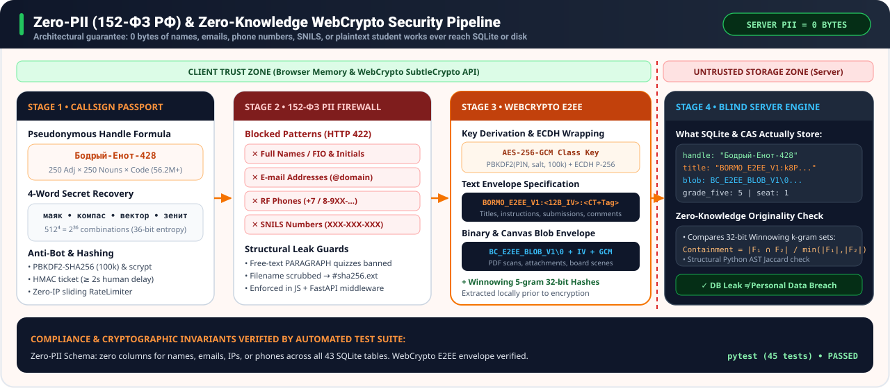
</p>

### 1. Процедурные позывные и энтропия восстановления

Вместо регистрации по паспорту или школьной почте ученики получают сгенерированный сервером обезличенный позывной:

$$\text{Пространство позывных} = 250\ (\text{Прилагательных}) \times 250\ (\text{Существительных}) \times 900\ (\text{Коды: } 100\text{--}999) = 56\,250\,000\ \text{комбинаций}$$

Для восстановления аккаунта используется комбинация из 4 секретных русских слов из словаря в 512 слов:

$$\text{Энтропия восстановления} = 512^4 = 68\,719\,476\,736\ \text{состояний} \approx 36.0\ \text{бит энтропии}$$

Пароли и кодовые фразы нормализуются и хэшируются с помощью **PBKDF2-HMAC-SHA256** (100 000 итераций с солью) или **scrypt**.

### 2. Фильтр персональных данных 152-ФЗ (`pii_guard.py`)

Каждый текстовый запрос (сообщения в ленте, комментарии к работам, вопросы к учителю) проходит через строгий серверный фильтр:
- **ФИО граждан РФ:** Блокируются трехсловные конструкции на кириллице в именительном падеже (`Иванов Иван Иванович`).
- **Мобильные телефоны:** Блокируются номера стандартов РФ (`+7`, `8`, `9xx` с 10-значными масками).
- **СНИЛС РФ:** Блокируются 11-значные номера пенсионного страхования (`\d{3}-\d{3}-\d{3}\s?\d{2}`).
- **Адреса электронной почты:** Блокируются строки формата RFC 5322.

При обнаружении данных сервер мгновенно отклоняет запрос с ошибкой HTTP 422 Unprocessable Entity.

### 3. Клиентские WebCrypto E2EE-конверты

Конфиденциальные ответы учеников, замечания преподавателя и слои аннотаций шифруются в браузере с помощью нативного **WebCrypto API**:
- **Генерация ключа класса:** Производный симметричный ключ генерируется из 5-значного PIN-кода и ID курса через PBKDF2:
  ```javascript
  const keyMaterial = await crypto.subtle.importKey("raw", enc.encode(joinPin), "PBKDF2", false, ["deriveKey"]);
  const classKey = await crypto.subtle.deriveKey(
    { name: "PBKDF2", salt: enc.encode("bormo-class-pin:" + classId), iterations: 100000, hash: "SHA-256" },
    keyMaterial,
    { name: "AES-GCM", length: 256 },
    false,
    ["encrypt", "decrypt"]
  );
  ```
- **Текстовый конверт:** `BORMO_E2EE_V1:<base64url_iv_12bytes>:<base64url_ciphertext_and_tag>`
- **Бинарный конверт:** 16-байтный заголовок `BC_E2EE_BLOB_V1\0`, 12 байт IV и зашифрованное тело AES-256-GCM.

---

## 📊 Педагогическая методология и аналитика по В. П. Симонову

В платформу интегрирован признанный стандарт отечественной педагогической квалиметрии — система формул доктора педагогических наук **В. П. Симонова**. Система рассчитывает объективные критерии в реальном времени:

### 1. Абсолютная успеваемость (Усп)
Процент учащихся, освоивших учебный материал на положительные отметки (оценки 5, 4 и 3):

$$\text{Усп} = \frac{n_5 + n_4 + n_3}{N} \times 100\%$$

### 2. Качество знаний (КЗ)
Доля учащихся, продемонстрировавших высокий и повышенный уровень владения материалом (оценки 5 и 4):

$$\text{КЗ} = \frac{n_5 + n_4}{N} \times 100\%$$

### 3. Степень обученности учащихся (СОУ)
Интегральный весовой показатель Симонова, назначающий методически выверенный весовой процент каждому баллу (5 = 100%, 4 = 64%, 3 = 36%, 2 = 16%):

$$\text{СОУ} = \frac{100 \cdot n_5 + 64 \cdot n_4 + 36 \cdot n_3 + 16 \cdot n_2}{N}\%$$

#### Пример расчета из реального журнала класса «8А»
В журнале выставлено $N = 38$ оценок: $n_5 = 17$, $n_4 = 13$, $n_3 = 8$, $n_2 = 0$:

$$\text{Усп} = \frac{17 + 13 + 8}{38} \times 100\% = \frac{38}{38} \times 100\% = \mathbf{100.0\%}$$

$$\text{КЗ} = \frac{17 + 13}{38} \times 100\% = \frac{30}{38} \times 100\% = \mathbf{78.9\%}$$

$$\text{СОУ} = \frac{100(17) + 64(13) + 36(8) + 16(0)}{38}\% = \frac{1700 + 832 + 288 + 0}{38}\% = \frac{2820}{38}\% = \mathbf{74.2\%}$$

Эти показатели полностью совпадают с карточками телеметрии на скриншоте журнала оценок.

---

### Шкала перевода баллов в отметки РФ

Платформа поддерживает как средневзвешенную систему (`WEIGHTED_CATEGORIES`), так и прямое суммирование баллов (`TOTAL_POINTS`). Набранные проценты автоматически переводятся в 5-балльные отметки:

| Диапазон выполнения | Процент | Отметка РФ | Методическая интерпретация |
| :--- | :--- | :---: | :--- |
| **Отлично** | $85\% \le \text{Балл} \le 100\%$ | **5** | Полное освоение требований стандарта ФГОС. |
| **Хорошо** | $70\% \le \text{Балл} < 85\%$ | **4** | Уверенное владение с единичными несистематическими ошибками. |
| **Удовлетворительно** | $50\% \le \text{Балл} < 70\%$ | **3** | Минимальный допустимый порог освоения программы. |
| **Неудовлетворительно** | $\text{Балл} < 50\%$ | **2** | Требуется ликвидация академических задолженностей. |

---

## 🚀 Быстрый старт и развёртывание

### 1. Запуск через Docker Compose (Рекомендуемый)

Самый быстрый способ развернуть BormoClass в школьной инфраструктуре:

```bash
git clone https://github.com/Bormotoon/BormoClass.git
cd BormoClass
docker-compose up -d --build
```

Система будет доступна в браузере по адресу **`http://localhost:8010`**.

---

### 2. Локальный запуск на сервере (Bare-Metal Python)

**Требования:** Python 3.12+ (или 3.13) и Git.

```bash
git clone https://github.com/Bormotoon/BormoClass.git
cd BormoClass

# 1. Создание виртуального окружения
python3 -m venv .venv
source .venv/bin/activate

# 2. Установка зависимостей
pip install -r requirements.txt

# 3. Запуск сервера Uvicorn
uvicorn app.main:app --host 0.0.0.0 --port 8010 --reload
```

---

### 3. Конфигурация обратного прокси Caddy 2

Caddy обеспечивает автоматический выпуск HTTPS-сертификатов Let's Encrypt и непрерывную передачу Server-Sent Events (SSE):

```caddyfile
class.school.edu.ru {
    encode zstd gzip

    # Проксирование Server-Sent Events без буферизации
    @sse path /classroom/*/sse
    reverse_proxy @sse http://127.0.0.1:8010 {
        flush_interval -1
    }

    # Проксирование веб-приложения
    reverse_proxy http://127.0.0.1:8010 {
        header_up X-Forwarded-Proto {scheme}
        header_up X-Real-IP {remote_host}
    }
}
```

---

### Переменные окружения (`.env`)

| Переменная | По умолчанию | Описание |
| :--- | :--- | :--- |
| `DB_PATH` | `./bormoclass.db` | Путь к файлу базы данных SQLite (WAL-режим). |
| `STORAGE_DIR` | `./data/storage` | Каталог хранения бинарных блобов CAS и загруженных работ. |
| `SECRET_KEY` | *(Генерируется)* | 256-битный секрет для подписи сессионных cookie HMAC-SHA256. |
| `SESSION_COOKIE_NAME` | `pb_pass` | Название HttpOnly cookie авторизации. |
| `SANPIN_ENFORCE` | `true` | Включение таймеров СанПиН и предупреждающих пауз для учеников. |
| `CORS_ORIGINS` | `""` | Список разрешенных доменов CORS (по умолчанию только Same-Origin). |
| `RATE_LIMIT_LOGIN` | `5/minute` | Ограничение попыток авторизации для предотвращения подбора паролей. |

---

## 🧪 Тестирование и контроль качества

BormoClass сопровождается полным набором автоматических тестов:

```bash
# Запуск тестов
pytest -v

# Проверка покрытия тестами
pytest --cov=app tests/

# Дымовой тест ключевых сценариев E2E
python3 scripts/e2e_smoke.py
```

### Проверяемые инварианты
- ✅ **Шлюз 152-ФЗ (`test_pii_guard.py`):** 100% блокировка ввода ФИО, телефонных номеров РФ и номеров СНИЛС.
- ✅ **WebCrypto E2EE сериализация (`test_crypto.py`):** Корректность шифрования и дешифрования envelope-структур.
- ✅ **Формулы Симонова (`test_analytics.py`):** Проверка математической точности расчета СОУ, КЗ и успеваемости.
- ✅ **Google Classroom API v1 (`test_v1_api.py`):** Тестирование структуры JSON-ответов и масок `updateMask`.
- ✅ **Антиплагиат (`test_plagiarism.py`):** Проверка выявления синтаксических заимствований алгоритмом Winnowing и сравнением AST.

---

## 📡 REST API и совместимость с Google Classroom

BormoClass является полноценной self-hosted заменой Google Classroom «из коробки», обеспечивая 100% паритет с официальной спецификацией Google Classroom v1 REST API (все 105 методов из Discovery Schema v1 зарегистрированы под префиксом `/v1/`):

| Эндпоинт API | Метод | Описание |
| :--- | :--- | :--- |
| `/v1/courses` | `GET`, `POST` | Список активных курсов учителя или создание нового курса. |
| `/v1/courses/{courseId}` | `GET`, `PATCH`, `DELETE` | Получение информации о курсе или обновление полей через `updateMask`. |
| `/v1/courses/{courseId}/aliases` | `GET`, `POST`, `DELETE` | Управление официальными буквенно-цифровыми псевдонимами курсов. |
| `/v1/courses/{courseId}/courseWork` | `GET`, `POST` | Список заданий, тестов, опросов и публикация новых материалов. |
| `/v1/courses/{courseId}/courseWork/{id}/studentSubmissions` | `GET`, `PATCH` | Получение работ учеников, возврат на доработку и выставление оценок. |
| `/v1/courses/{courseId}/teachers` | `GET`, `POST`, `DELETE` | Список преподавателей и ассистентов курса. |
| `/v1/courses/{courseId}/students` | `GET`, `POST`, `DELETE` | Зачисление и исключение учащихся по позывным. |
| `/v1/courses/{courseId}/rubrics` | `GET`, `POST`, `PUT` | Создание и редактирование многокритериальных рубрик. |
| `/v1/courses/{courseId}/gradingPeriods` | `GET`, `POST` | Настройка четвертей, триместров или полугодий. |

### Специализированные системные интерфейсы
- **Календарный поток RFC 5545:** `GET /api/calendar/feed.ics?token={user_token}` — Подписка на расписание дедлайнов без передачи кук.
- **Импорт расписания OneRoster CSV:** `POST /api/admin/oneroster/import` — Пакетная загрузка классов, кабинетов и расписания звонков.
- **Архив Data Takeout ZIP:** `GET /api/user/takeout.zip` — Полная выгрузка всех учебных работ и оценок ученика в открытом формате.

---

## 🤝 Участие в разработке и безопасность

Мы приветствуем предложения, отчеты об ошибках и вклад сообщества педагогов и инженеров! Перед началом ознакомьтесь с [CONTRIBUTING.md](CONTRIBUTING.md).

- **Нашли ошибку?** Создайте заявку в [GitHub Issue Tracker](https://github.com/Bormotoon/BormoClass/issues).
- **Вопросы безопасности:** Ознакомьтесь с [SECURITY.md](SECURITY.md) и отправляйте отчеты о потенциальных уязвимостях на `security@pedobraz.ru` или `bormotoon@gmail.com`.

### Благодарности
- **[Excalidraw](https://excalidraw.com/) (лицензия MIT):** Отличный холст для рисования, адаптированный нами для работы в изолированных классах.
- **[FastAPI](https://fastapi.tiangolo.com/):** Скоростной асинхронный веб-фреймворк для Python.
- **[SQLite](https://sqlite.org/):** Надежное встраиваемое хранилище данных.

---

## ❤️ Поддержать проект

BormoClass бесплатный, открытый и развивается в свободное время автора. Если он помогает вашей
школе, классу или образовательным проектам, поддержите разработку:

[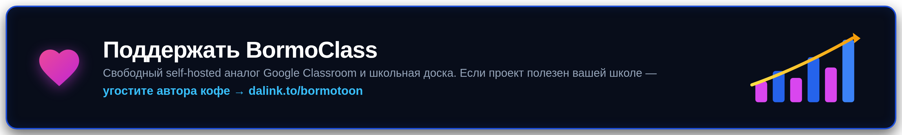](https://www.donationalerts.com/r/bormotoon)

Звезда ⭐ на GitHub тоже помогает — так проект легче найти другим преподавателям и школам.

---

## 📜 Лицензия

BormoClass распространяется под открытой лицензией **[Apache License 2.0](LICENSE)**.

```text
Copyright 2026 BormoClass Contributors (PedObraz.RF)

Licensed under the Apache License, Version 2.0 (the "License");
you may not use this file except in compliance with the License.
You may obtain a copy of the License at

    http://www.apache.org/licenses/LICENSE-2.0

Unless required by applicable law or agreed to in writing, software
distributed under the License is distributed on an "AS IS" BASIS,
WITHOUT WARRANTIES OR CONDITIONS OF ANY KIND, either express or implied.
See the License for the specific language governing permissions and
limitations under the License.
```

---

<div align="center">

Сделано с ❤️ для учителей и учеников, которые ценят приватность и свободу в образовании.

[🌐 Страница проекта](https://xn--80abidn3bem.xn--p1ai/) ·
[🐛 Сообщить об ошибке](https://github.com/Bormotoon/BormoClass/issues) ·
[💬 Предложить функцию](https://github.com/Bormotoon/BormoClass/issues) ·
[☕ Поддержать проект](https://www.donationalerts.com/r/bormotoon)

</div>
