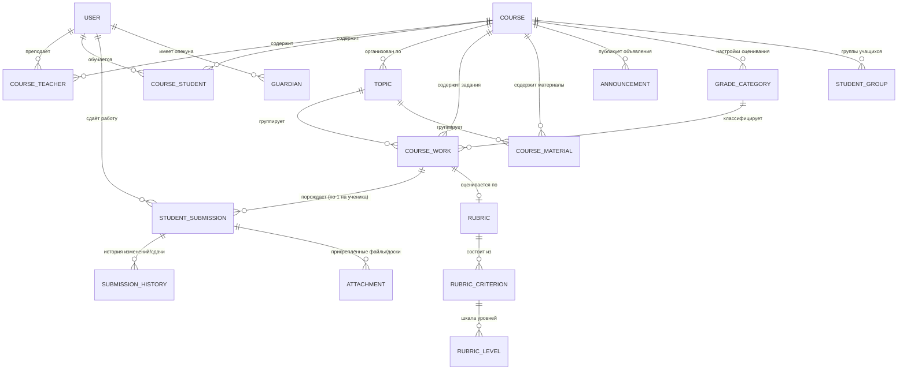

# Архитектура и Модели Данных Google Classroom (Спецификация для BormoClass)

Данный документ содержит полное описание структуры сущностей, их атрибутов, типов связей и кардинальности в Google Classroom. Спецификация составлена на основе официального Discovery Schema v1 и руководств разработчика Google.

---

## 1. Диаграмма связей сущностей (Entity-Relationship Diagram)

---

## 2. Детальный реестр сущностей

### 2.1. Course (Курс / Класс)
Основная организационная единица учебного процесса.

| Поле | Тип | Описание |
|---|---|---|
| `id` | string (PK) | Уникальный идентификатор курса. |
| `name` | string (req) | Название курса (например: «Алгебра 10А»). |
| `section` | string | Секция / подгруппа (например: «Группа 1», «2026/2027»). |
| `descriptionHeading` | string | Заголовок описания. |
| `description` | string | Подробное описание курса, правила, ссылки. |
| `room` | string | Номер аудитории или онлайн-комнаты. |
| `ownerId` | string (FK -> User) | Идентификатор создателя / главного преподавателя (владельца). |
| `creationTime` | timestamp (ISO) | Время создания курса. |
| `updateTime` | timestamp (ISO) | Время последнего обновления. |
| `enrollmentCode` | string | Код приглашения (6-7 символов) для самостоятельного вступления учеников. |
| `courseState` | enum | Состояние жизненного цикла курса (`ACTIVE`, `ARCHIVED`, `PROVISIONED`, `DECLINED`, `SUSPENDED`). |
| `alternateLink` | string | URL для открытия курса в веб-интерфейсе. |
| `teacherFolder` | DriveFolder / object | Папка материалов курса на диске преподавателя. |
| `gradebookSettings` | object | Настройки журнала оценок (расчет общей оценки, категории). |

---

### 2.2. CourseWork (Учебное задание / Вопрос)
Элемент учебной работы, назначенный учащимся. Бывает трёх типов: задание, вопрос с коротким ответом, вопрос с выбором ответа.

| Поле | Тип | Описание |
|---|---|---|
| `id` | string (PK) | Уникальный ID задания. |
| `courseId` | string (FK -> Course) | Идентификатор курса. |
| `title` | string (req) | Название задания. |
| `description` | string | Формулировка, инструкция к выполнению. |
| `materials` | array[Material] | Прикреплённые преподавателем материалы (ссылки, файлы, видео, интерактивные доски). |
| `state` | enum | Состояние публикации: `DRAFT`, `PUBLISHED`, `SCHEDULED`, `DELETED`. |
| `alternateLink` | string | Ссылка на задание в веб-интерфейсе. |
| `creationTime` | timestamp | Дата создания. |
| `updateTime` | timestamp | Дата обновления. |
| `dueDate` | Date `{year, month, day}` | Дата дедлайна сдачи. |
| `dueTime` | TimeOfDay `{hours, minutes}` | Время дедлайна сдачи (UTC). |
| `scheduledTime` | timestamp | Время отложенной авто-публикации. |
| `maxPoints` | float / int | Максимальный балл (например, 100 или 5; если 0 — задание без оценки). |
| `workType` | enum | Тип задания: `ASSIGNMENT`, `SHORT_ANSWER_QUESTION`, `MULTIPLE_CHOICE_QUESTION`. |
| `associatedWithDeveloper` | boolean | Создано ли внешним приложением/интеграцией. |
| `assigneeMode` | enum | Кому назначено: `ALL_STUDENTS` или `INDIVIDUAL_STUDENTS`. |
| `individualStudentsOptions` | object | Список `studentIds`, если назначено выборочно. |
| `submissionModificationMode`| enum | Разрешено ли изменять сданную работу (`MODIFIABLE_UNTIL_TURNED_IN`, `MODIFIABLE`). |
| `creatorUserId` | string (FK -> User) | Преподаватель, создавший задание. |
| `topicId` | string (FK -> Topic) | Тема / модуль, к которому привязано задание. |
| `gradeCategoryId` | string (FK -> Category) | Категория оценивания (например: «Контрольные», «ДЗ»). |

---

### 2.3. StudentSubmission (Сдача работы учеником)
Экземпляр выполнения конкретного задания конкретным учеником. Создаётся системой автоматически при публикации задания для каждого назначенного ученика.

| Поле | Тип | Описание |
|---|---|---|
| `id` | string (PK) | Уникальный ID сдачи. |
| `courseId` | string (FK -> Course) | Идентификатор курса. |
| `courseWorkId` | string (FK -> CourseWork)| Идентификатор задания. |
| `userId` | string (FK -> User) | Идентификатор ученика. |
| `creationTime` | timestamp | Время создания записи о сдаче. |
| `updateTime` | timestamp | Время последнего действия. |
| `state` | enum | Состояние: `NEW`, `CREATED`, `TURNED_IN`, `RETURNED`, `RECLAIMED_BY_STUDENT`. |
| `late` | boolean | Сдано ли после наступления срока (`dueDate` + `dueTime`). |
| `draftGrade` | float | Черновая оценка (видна только преподавателю до возврата работы). |
| `assignedGrade` | float | Итоговая выставленная оценка (становится видна ученику после `RETURN`). |
| `alternateLink` | string | Ссылка на просмотр сдачи. |
| `courseWorkType` | enum | `ASSIGNMENT`, `SHORT_ANSWER_QUESTION`, `MULTIPLE_CHOICE_QUESTION`. |
| `assignmentSubmission` | object | Содержит список прикреплений ученика (`attachments`). |
| `shortAnswerSubmission` | object | Текстовый ответ ученика (для вопросов с коротким ответом). |
| `multipleChoiceSubmission` | object | Выбранный вариант ответа. |
| `submissionHistory` | array | Журнал всех переходов состояний и выставлений оценок с метками времени. |

---

### 2.4. Topic (Тема / Раздел)
Используется для смысловой группировки заданий и материалов на странице курса («Задания»).

| Поле | Тип | Описание |
|---|---|---|
| `topicId` | string (PK) | Уникальный идентификатор темы. |
| `courseId` | string (FK -> Course) | Курс, которому принадлежит тема. |
| `name` | string (req) | Название темы (например: «Тригонометрия», «Модуль 1. Введение»). |
| `updateTime` | timestamp | Время последнего обновления. |

---

### 2.5. CourseWorkMaterial (Учебный материал)
Информационный пост без оценивания и без механизма сдачи работы (лекция, конспект, ссылки на учебники).

| Поле | Тип | Описание |
|---|---|---|
| `id` | string (PK) | ID материала. |
| `courseId` | string (FK -> Course) | Курс. |
| `title` | string (req) | Название материала. |
| `description` | string | Пояснительный текст. |
| `materials` | array[Material] | Ссылки, файлы, видео, доски. |
| `state` | enum | `DRAFT`, `PUBLISHED`, `SCHEDULED`, `DELETED`. |
| `topicId` | string (FK -> Topic) | Привязка к теме. |
| `assigneeMode` | enum | `ALL_STUDENTS` или `INDIVIDUAL_STUDENTS`. |

---

### 2.6. Announcement (Объявление в Ленте)
Сообщение в ленте курса («Стрим / Лента новостей») для коммуникации со студентами.

| Поле | Тип | Описание |
|---|---|---|
| `id` | string (PK) | ID объявления. |
| `courseId` | string (FK -> Course) | Курс. |
| `text` | string (req) | Текст объявления. |
| `materials` | array[Material] | Вложения. |
| `state` | enum | `DRAFT`, `PUBLISHED`, `SCHEDULED`, `DELETED`. |
| `creatorUserId` | string (FK -> User) | Автор объявления. |
| `creationTime` | timestamp | Дата публикации. |
| `assigneeMode` | enum | `ALL_STUDENTS` или `INDIVIDUAL_STUDENTS`. |

---

### 2.7. Rubric & RubricCriterion (Критерии оценивания)
Структурированная рубрика для детальной оценки задания по шкале параметров.

| Поле | Тип | Описание |
|---|---|---|
| `id` | string (PK) | Идентификатор рубрики. |
| `courseId` | string (FK -> Course) | Курс. |
| `courseWorkId` | string (FK -> CourseWork)| Задание, к которому привязана рубрика (1 к 1). |
| `criteria` | array[Criterion] | Список критериев оценки. |
| `criteria[i].id` | string | ID критерия (например: «Грамотность», «Полнота решения»). |
| `criteria[i].title` | string | Название критерия. |
| `criteria[i].description` | string | Пояснение к критерию. |
| `criteria[i].weight` | float | Вес или максимальные баллы по критерию. |
| `criteria[i].levels` | array[Level] | Уровни выполнения: `title` («Отлично», «Хорошо»), `points` (10, 5, 0), `description`. |

---

### 2.8. GradeCategory & GradingPeriod (Система оценивания)
Позволяет настраивать средневзвешенный балл и учебные периоды (четверти / семестры).

| Поле | Тип | Описание |
|---|---|---|
| `id` | string (PK) | ID категории. |
| `name` | string | Название («Лабораторные», «Домашние задания», «Экзамен»). |
| `weight` | int / float | Вес в процентах (например, 40%, 30%, 30%). |
| `defaultMaxPoints` | int | Баллы по умолчанию для заданий данной категории. |

---

### 2.9. Guardian & GuardianInvitation (Опекуны / Родители)
Связка ученика с его родителями для отправки еженедельных дайджестов об успеваемости и долгах.

| Поле | Тип | Описание |
|---|---|---|
| `studentId` | string (FK -> User) | Идентификатор учащегося. |
| `guardianId` | string (FK -> User) | Идентификатор подтверждённого родителя. |
| `guardianEmail` | string | Email родителя. |
| `invitationId` | string | ID отправленного приглашения родителю. |
| `state` | enum | Состояние приглашения: `PENDING`, `COMPLETE`. |
