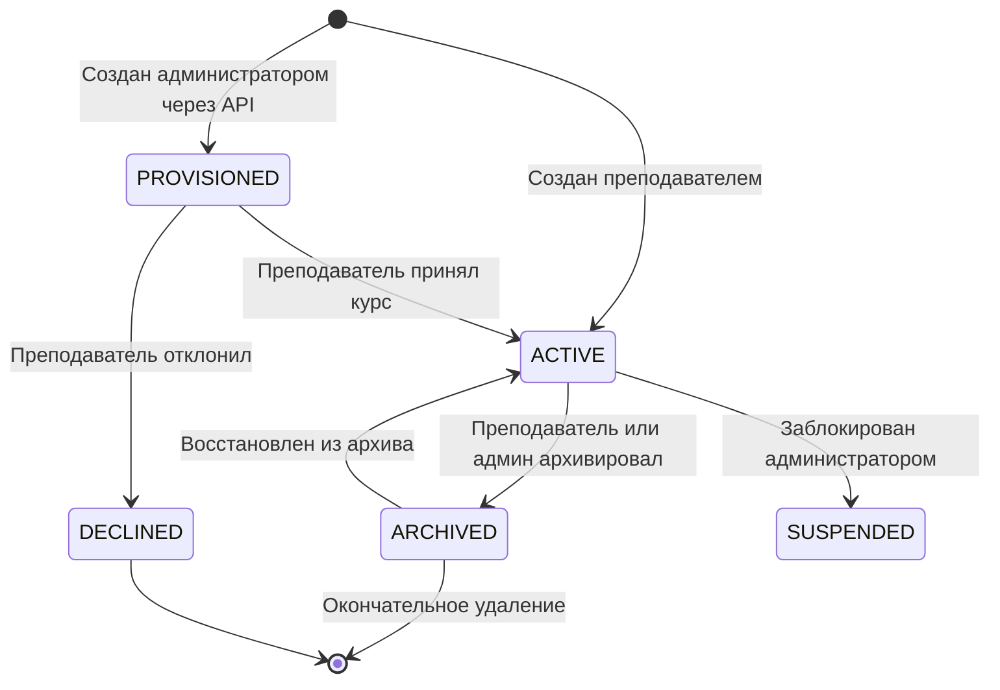
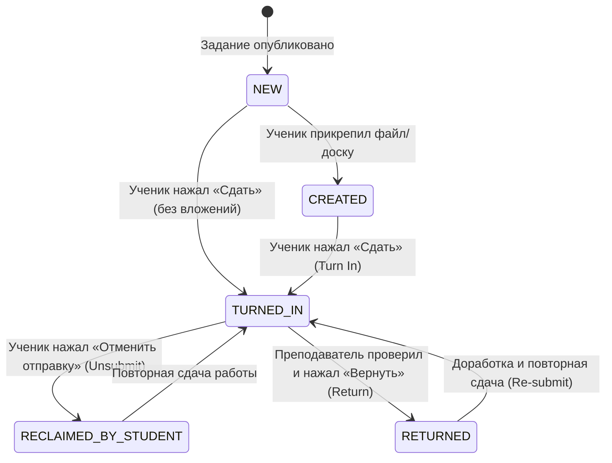
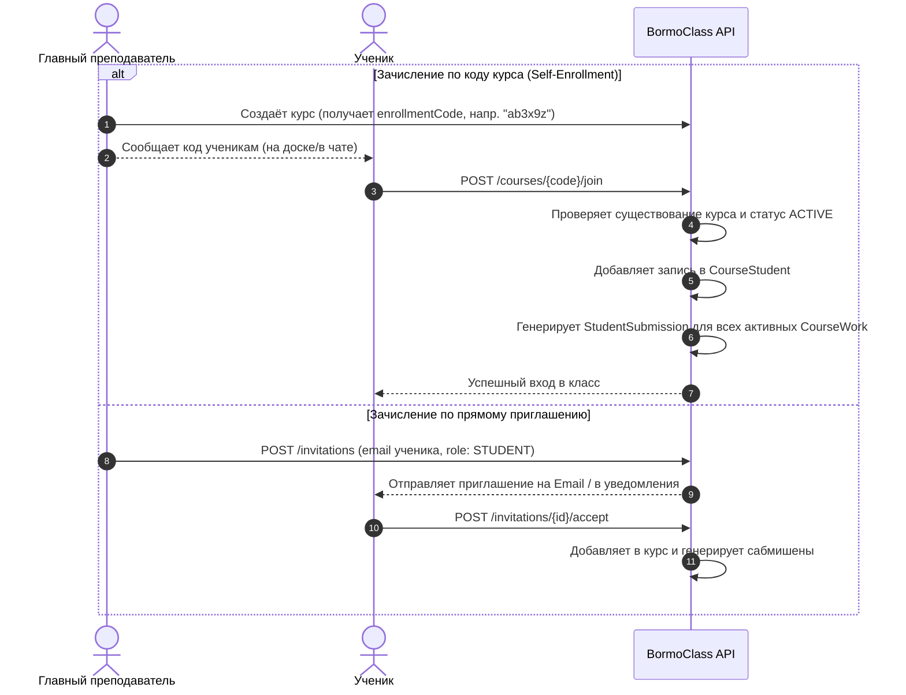

# Жизненные циклы и рабочие процессы (Lifecycles & Workflows) Google Classroom

В этом документе формализованы все конечные автоматы (State Machines) и сценарии взаимодействия ролей в Google Classroom. Это эталонная логика для воспроизведения в BormoClass.

---

## 1. Жизненный цикл курса (Course Lifecycle)



### Поведение состояний:
- **`ACTIVE`**:
  - Полный доступ: преподаватели публикуют задания и выставляют оценки; студенты сдают работы; курс виден в основном списке.
- **`ARCHIVED`**:
  - Режим «только чтение» (Read-Only) для преподавателей и студентов.
  - Нельзя публиковать новые задания, сдавать работы или менять оценки.
  - Курс уходит из главного списка в специальную секцию «Архив курсов».
  - Сохраняется вся история сдачи работ, файлы и оценки.
  - В любой момент курс может быть разархивирован (`ACTIVE`).
- **`PROVISIONED`**:
  - Предварительно сгенерированный курс (например, из внешней школьной информационной системы / SIS).
  - Назначенный преподаватель видит плашку с кнопками «Принять» или «Отклонить».
- **`DECLINED`**:
  - Преподаватель отказался от владения курсом.

---

## 2. Жизненный цикл сдачи работы учеником (StudentSubmission State Machine)

Это ключевой механизм учебного процесса. При публикации задания (`CourseWork`) система **автоматически генерирует объект `StudentSubmission` в состоянии `NEW` для каждого назначенного ученика**.



### Детальное описание состояний и прав доступа к файлам/вложениям:

| Состояние | Кто имеет право редактировать вложения | Видимость оценки | Описание |
|---|---|---|---|
| **`NEW`** | Ученик | Оценки нет | Задание назначено, ученик ещё не вносил изменений и не прикреплял файлы. |
| **`CREATED`** | Ученик | Оценки нет | Ученик создал черновик ответа, загрузил файлы или создал интерактивную доску. Преподаватель может видеть промежуточный прогресс. |
| **`TURNED_IN`** | Преподаватель (ученик переходит в Read-Only!) | Преподаватель может ставить `draftGrade` (ученику не видна) | Работа официально сдана на проверку. Ученик **теряет права на редактирование** прикреплённых файлов/досок, чтобы предотвратить правки задним числом. |
| **`RECLAIMED_BY_STUDENT`** | Снова Ученик | Оценки нет | Ученик нажал «Отменить отправку» (`reclaim`), чтобы внести исправления до проверки. Ученику возвращаются права редактирования. |
| **`RETURNED`** | Ученик (снова может править) | Ученику становится видна `assignedGrade` | Преподаватель завершил проверку и нажал «Вернуть» (`return`). Выставленная оценка фиксируется в `assignedGrade`. Ученик может ознакомиться с замечаниями и при необходимости сдать работу повторно. |

---

## 3. Расчёт признака опоздания (`late`)

Поле `late: boolean` в `StudentSubmission` вычисляется динамически при каждом действии `turnIn`:

```python
def check_is_late(submission_turned_in_time, course_work):
    if not course_work.due_date:
        return False  # Бессрочное задание никогда не бывает просроченным

    due_datetime = combine_date_and_time(
        course_work.due_date, 
        course_work.due_time or TimeOfDay(hours=23, minutes=59, seconds=59)
    )
    return submission_turned_in_time > due_datetime
```

- Если ученик сдал работу после дедлайна, на плашке сдачи отображается статус **«Сдано с опозданием»** (Done late).
- Если дедлайн наступил, а работа осталась в `NEW` или `CREATED`, в интерфейсе ученика и преподавателя отображается статус **«Просрочено» / «Не сдано»** (Missing).

---

## 4. Рабочий процесс оценивания (Grading Workflow)

Google Classroom разделяет оценку на две стадии: **Черновик (`draftGrade`)** и **Итоговая оценка (`assignedGrade`)**.

1. **Черновой ввод (`patch studentSubmission`):**
   - Преподаватель вводит балл (например, `85 / 100`) и пишет личный комментарий.
   - Значение сохраняется в `draftGrade`.
   - **Ученик НЕ видит этот балл**, пока преподаватель не вернёт работу. Это позволяет учителю спокойно проверить весь класс, скорректировать шкалу и опубликовать оценки одновременно.

2. **Возврат работы (`return studentSubmissions`):**
   - Преподаватель выбирает одного, нескольких или всех учеников и нажимает «Вернуть» (`Return`).
   - Значение `draftGrade` переносится в `assignedGrade`.
   - Состояние работы переходит в `RETURNED`.
   - Ученик получает уведомление с итоговым баллом и приватными комментариями.

3. **Оценка по рубрикам (Rubrics Scoring):**
   - Если к заданию прикреплена `Rubric`, преподаватель оценивает работу, кликая по уровням в каждом критерии (например: «Логика решения: 10/10», «Оформление: 4/5»).
   - Сумма баллов по критериям автоматически вычисляет `draftGrade`.

---

## 5. Режимы назначения заданий (Assignee Modes)

Задание или объявление может назначаться в одном из трёх режимов:

1. **`ALL_STUDENTS`** (по умолчанию):
   - Задание назначается всем ученикам, зачисленным в класс.
   - Новые ученики, вступившие в класс позже, также автоматически получают это задание.

2. **`INDIVIDUAL_STUDENTS`** (дифференцированное обучение):
   - Задаётся явный список `studentIds`.
   - Только эти ученики видят задание в ленте и в списке работ.
   - Остальные ученики даже не знают о существовании этого задания (удобно для олимпиадных задач или работы над ошибками).

3. **`STUDENT_GROUPS`** (групповые задания):
   - Ученики разбиваются на подгруппы (бригады, варианты). Задание выдается конкретной группе.

---

## 6. Процесс зачисления учащихся и преподавателей


